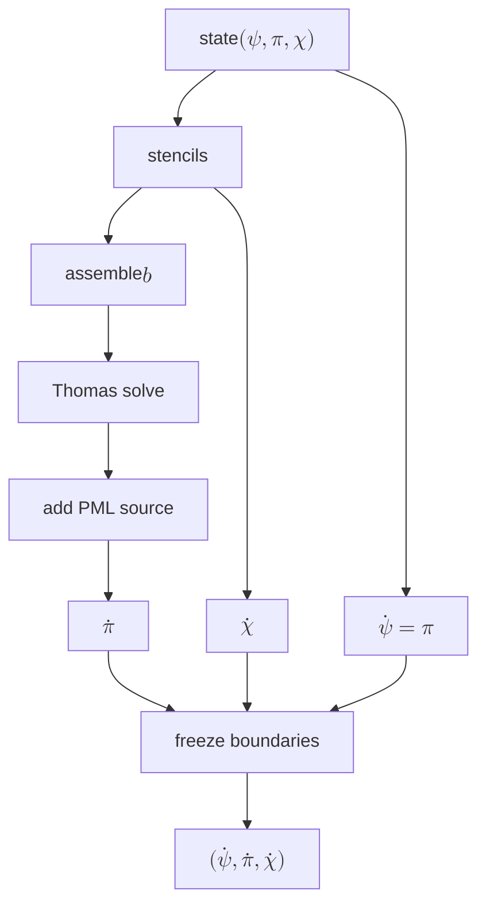

# 2. Physics background
After performing the reduction to $1+1D$ (the details of which we omit here), we are left with a wavefunction $$\Psi = \sum_{j = |m|}^\infty \psi_j(t,r) Y_{jm}(\theta).$$
We define $\pi_j \equiv \dot{\psi}_j$, so we have two first-order-in-time equations that RK4 can accept as input. Dolan's equation (25) reads
$$\begin{aligned}\left[\Sigma_{(0)}^2 + a^2 \Delta c_{ll}^m\right] \dot{\pi}_l 
&+ a^2 \Delta \left(c_{l,l+2}^m \dot{\pi}_{l+2} + c_{l,l-2}^m \dot{\pi}_{l-2}\right) = \\
&(r^2+a^2)^2 \psi_l'' + \left(2iam(r^2+a^2) - 2a^2\Delta/r\right)\psi_l' \\
&-4iamMr\pi_l - V_l\psi_l - a^2\mu^2 \Delta \left(c_{l,l+2}\psi_{l+2} + c_{l,l-2}\psi_{l-2}\right).\end{aligned}$$
In the equation above,
* $a$ is the dimensionless spin of the BH
* $\Delta = r^2 - 2Mr + a^2$
* $c_{j\ell}^m$ is a matrix element that is zero unless $j=\ell-2, \ell, \ell+2$
* $\Sigma_{(0)}^2 = (r^2 + a^2)^2 - a^2 \Delta$
* $V = \Delta \left[\ell(\ell+1) + \frac{2M}{r} \left(1 - \frac{a^2}{Mr}\right) + \frac{2iam}{r} + \mu^2 (r^2 + a^2 c_{\ell\ell}^m) \right]$
(Note that our definition of $V_\ell$ drops a $\psi_\ell$ compared to Dolan.)

When taken as a collective across all coupled $\ell$ modes, we have a matrix equation
$$\mathbf{A}\dot{\mathbf{x}} = \mathbf{b},$$
where $\mathbf{x}$ is a vector of all the coupled $\pi_\ell$ -- that is, $(\pi_{|m|}, \pi_{|m|+2}, \cdots)^\top$ or $(\pi_{|m|+1}, \pi_{|m|+3}, \cdots)^\top$ -- and $\mathbf{A}$ is a tridiagonal matrix. We implement this using `Tower` (see section 4) and solve it using the methods outlined in section 5.

# 3. Module map

Dolan modules live in `src/dolan/`; independent benchmarks and plotting live
in `src/common/`. The new adiabatic method lives in `src/adiabatic/` and has its
own checkpoint document, `adiabatic-repro.md`.
* `solver.py`: `KerrTortoise` grid, `Tower` to model the same-parity $\ell$ spectrum of Dolan's eq. (25), and method of lines implementation.
* `leaver.py`: Canonical continued-fraction solver as a benchmark to check our results against. Our operator contains an $a^2 \mu^2 \cos^2 \theta$ term, so we set `spheroidal=True` for Leaver to match.
* `qbs_eigenmode.py`: Diagonalizes the `Tower` operator from `solver` to get the (linear) complex eigenfrequency cheaply.
* `fig13_growth_rates.py`: Calculates and plots the `qbs_eigenmode.py` linear rate across a range of $\alpha$.
* `frequency_filter.py`: Isolates one mode of the system from a provided signal.
* `measure_gamma.py`: Evolves the system and uses `frequency_filter` to extract the growth rate $\Gamma$.
* `analyze_timedomain_run.py`: Loads the output of an existing `measure_gamma.py` run and re-analyzes it.
* `runs/`: Directory for SLURM files, run outputs, and logs. See `runs/README.md`.

# 4. Core data model: `Tower`
## 4.1 State
The state of `Tower` comprises a tuple of complex arrays `state = (psi, pi, chi)`, each shaped `(n_channels, n_points)`. These correspond to the scalar field, the time derivative of the scalar field, and the PML field (which is zero outside the PML strip) respectively. Each channel corresponds to a value of the angular momentum quantum number $\ell \in \{|m|, |m|+2, \ldots, \ell_\text{max}\}$. Note that because $\chi$ and $\gamma$ vanish in the non-PML region, the three-field system reduces exactly to the two-field system there.

## 4.2 Precomputed quantities
Everything else `Tower` holds is fixed for the whole run, depending only on the black hole (`spin`, `M`), the field (`alpha`), and the grid (`x_left`, `x_right`, `grid_spacing_n`, `l_max`). It is all built once in `__init__`. 

| Name | Shape | Description |
|---|---|---|
| `self.tortoise` | — | `KerrTortoise` instance: the analytic map $x(r)$ and its numerical inverse `r_x` |
| `self.x` | `(n_points,)` | uniform grid in the tortoise coordinate $x$ |
| `self.r` | `(n_points,)` | Boyer–Lindquist radius at each node; one Newton inversion of $x(r)$ at construction (see §6) |
| `self.Delta` | `(n_points,)` | $\Delta$ |
| `self.a2Delta` | `(n_points,)` | $a^2\Delta$; scales `c_matrix` inside $\mathbf{A}$ |
| `self.Sigma2_0` | `(n_points,)` | $\Sigma_{(0)}^2$ |
| `self.coeff_psi_xx` | `(n_points,)` | coefficient of $\psi_\ell''$ in Eq. (25), $(r^2+a^2)^2$ |
| `self.coeff_psi_x` | `(n_points,)` | coefficient of $\psi_\ell'$ |
| `self.coeff_pi` | `(n_points,)` | coefficient of $\pi_\ell$, $-4iamMr$ |
| `self.potential` | `(n_channels, n_points)` | $V_\ell$ (Eq. 26) — the only $\ell$-dependent precompute |
| `self.c_matrix` | `(n_channels, n_channels)` | angular coupling coefficients $c^m_{j\ell}$ |
| `self.l_values` | `n_channels` | the $\ell$ value of each channel |
| `self.Omega_H` | scalar | horizon angular velocity $a/(r_+^2+a^2)$, for the PML source |
| `self.pml_gamma` | `(n_points,)` | PML damping profile $\gamma(x)$ |

(Plus the scalars it was built from: `spin`, `alpha`, `m`, `dx`, `n_channels`,
`num_points`.)

## 4.3 State-dependent quantities
Everything that depends on the current `(psi, pi, chi)` is rebuilt on every `rhs` call. None of it is stored on the `Tower` — these are locals, listed here for contrast with the table above. See section 5 for how they fit together.

| Name | Shape | Description |
|---|---|---|
| `psi_x`, `psi_xx` | `(n_channels, n_points)` | 4th-order 5-point stencil first and second derivatives of $\psi$ |
| `chi_x` | `(n_channels, n_points)` | 4th-order 5-point stencil first derivative of $\chi$ |
| `b` | `(n_channels, n_points)` | explicit right-hand side of Eq. (25): every term that is not a $\dot\pi$ |
| `coupling` | `(n_channels, n_points)` | the $\ell\pm2$ neighbour-$\psi$ contraction folded into `b` (skipped when `n_channels == 1`) |
| `sub`, `diag`, `sup` | `(n_channels, n_points)` each | the three diagonals of $\mathbf{A}$, from `build_A_diagonals()` |
| `pi_dot` | `(n_channels, n_points)` | Thomas solve of $\mathbf{A}\,\dot{\pi} = b$, with the PML source added where $\gamma > 0$ |
| `chi_dot` | `(n_channels, n_points)` | PML auxiliary evolution (Eq. 44) |
| `psi_dot` | `(n_channels, n_points)` | a copy of $\pi$ |

Note that $\mathbf{A}$ is static, but `build_A_diagonals()` still rebuilds its diagonals every call rather than caching them. This is deliberate: the diagonals are three cheap array multiplies, and not caching keeps `rhs` a single self-contained function.

# 5. Control flow

The block diagram below shows the flow for `Tower.rhs`, the outputs of which feed into the RK4 solver.

