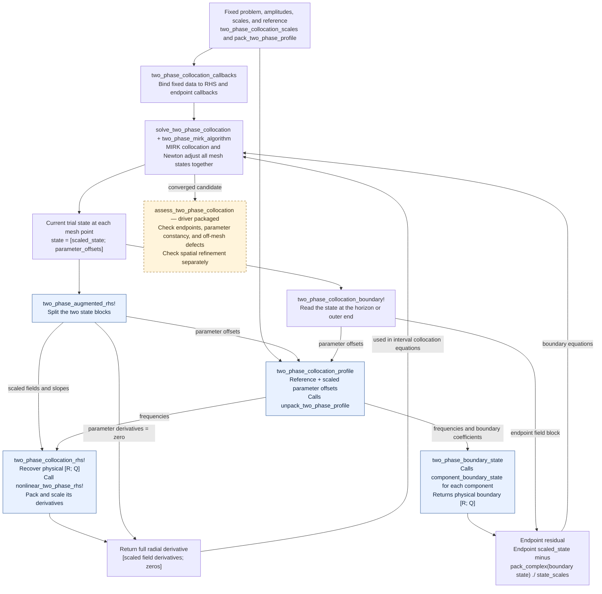

# Multiphase radial collocation: function map

This schematic follows the incremental migration from the
[radial BVP experiment](../runs/adiabatic/radial_bvp/README.md) into
[`src/adiabatic/multiphase/collocation.jl`](../src/adiabatic/multiphase/collocation.jl).
The coordinate/RHS helpers, endpoint callbacks, fixed-scale preparation, and
optional MIRK solve wrapper are present in `src` as of October 28, 2026. The
tested assessment helper currently ships with the campaign driver, ready to
move into `collocation.jl`. The amber box marks that driver-packaged helper.
See the [learning map](multiphase-learning-map.md#4a-adaptive-collocation-profiles)
for the reading checklist and current source locations.

## What the solver adjusts

The solver adjusts the radial fields, slopes, frequencies, and free boundary
coefficients together. All derivatives in this document are with respect to
tortoise radius `r*`, with `Q = dR/dr*`.

At each mesh point, the real state has two blocks:

```text
state = [scaled_state; parameter_offsets]
         └──────────┘ └───────────────┘
         fields/slopes  frequencies and free boundary coefficients
         56 real       56 real                  (14-mode case)
```

The coordinate conversions are:

```julia
scaled_state = pack_complex([R; Q]) ./ state_scales
packed_reference = pack_two_phase_profile(reference_profile, problem)
packed_parameters = packed_reference .+ parameter_scales .* parameter_offsets
profile = unpack_two_phase_profile(packed_parameters, amplitudes, problem)
```

`pack_complex` puts all real parts before all imaginary parts. Thus the field
block has ordering `[Re R; Re Q; Im R; Im Q]`. The parameter block follows the
separate ordering defined by `pack_two_phase_profile`.

For 14 retained radial modes, the parameter block contains two complex
frequencies, 14 complex horizon coefficients, and 12 complex free outer
coefficients: 28 complex or 56 real entries. The two prescribed fundamental
outer amplitudes are supplied separately through `amplitudes`.

`TwoPhaseProfile` stores the frequencies and physical boundary coefficients.
The spatial field and slope values reside in the collocation state at each
mesh point. `state_scales`, `parameter_scales`, `packed_reference`, `amplitudes`,
and the `TwoPhaseProblem` are fixed inputs during one solve.

## Function interactions

Arrows show data passed between calculations. A box can include a routine
that it calls internally. The endpoint path represents a separate evaluation
at each end of the domain; it decodes the parameters from that endpoint's
current trial state.



The central connection is `two_phase_collocation_profile`: both the radial
equations and the endpoint equations must use the current trial parameters.
The radial equations use the decoded frequencies. The endpoint equations use
the decoded frequencies and boundary coefficients.

## What happens inside the callbacks

`two_phase_augmented_rhs!` splits the state using the supplied array lengths.
It decodes the parameter offsets with `two_phase_collocation_profile`, passes
the field block and decoded frequencies to `two_phase_collocation_rhs!`,
and fills the parameter derivatives with zero. The latter helper reverses
the field scaling, calls the existing physical equations, and scales the
resulting derivatives. `nonlinear_two_phase_rhs!` continues to assemble the
linear component operators and the joint nonlinear source.

Zero parameter derivatives require the parameters to be constant across the
radial domain. Newton still adjusts their values. The boundary coefficients
enter the endpoint equations; the local radial RHS depends on the fields and
frequencies.

At each endpoint, the residual callback decodes that endpoint's
parameter block, call `two_phase_boundary_state`, pack and scale its result,
and subtract it from the endpoint field block. `two_phase_boundary_state`
calls the existing asymptotic boundary machinery through
`component_boundary_state`, then collects all fields before all slopes.
Each endpoint contributes 56 real equations in the 14-mode case, giving
112 boundary equations for the 112-state augmented system.

The MIRK library builds interpolating profiles between mesh points and the
collocation equations that require their derivatives to agree with our RHS.
Newton corrects the mesh states using those equations and both endpoint
residuals together. Adaptive refinement can add or redistribute mesh points.
The parameters and physical field values must be transferred consistently
when the mesh changes.

## Source map and remaining connections

| Function or piece | Responsibility | Location/status |
|---|---|---|
| `pack_two_phase_profile` | Pack reference frequencies and scaled free boundary coefficients | Existing, `multiphase/profiles.jl` |
| `two_phase_collocation_profile` | Convert parameter offsets into a physical `TwoPhaseProfile` | Added, `multiphase/collocation.jl` |
| `unpack_two_phase_profile` | Recover physical coefficients and insert prescribed outer amplitudes | Existing, `multiphase/profiles.jl` |
| `two_phase_augmented_rhs!` | Evaluate the field block and zero parameter derivatives | Added, `multiphase/collocation.jl` |
| `two_phase_collocation_rhs!` | Convert between scaled real coordinates and the physical radial RHS | Added, `multiphase/collocation.jl` |
| `nonlinear_two_phase_rhs!` | Evaluate the coupled physical radial equations | Existing, `multiphase/radial.jl` |
| `two_phase_boundary_state` | Assemble the complete physical endpoint state | Extracted, `multiphase/profiles.jl` |
| `component_boundary_state` | Evaluate one component's horizon or outer boundary series | Existing, `multiphase/radial.jl` |
| `two_phase_collocation_boundary!` | Compare endpoint field unknowns with their boundary-series values | Added, `multiphase/collocation.jl` |
| `two_phase_collocation_callbacks` | Bind fixed inputs to three BVP callback signatures | Added, `multiphase/collocation.jl` |
| `two_phase_collocation_scales` | Choose and freeze field/slope and parameter displacement scales | Added, `multiphase/collocation.jl` |
| `two_phase_mirk_algorithm`, `solve_two_phase_collocation` | Construct and solve the adaptive BVP | Added, `multiphase/collocation_mirk.jl` |
| `assess_two_phase_collocation` | Recover physical samples and independently check residuals | Tested, currently packaged with the campaign driver |

The optional loader installs the experiment's tested Jacobian-band and
mesh-transfer corrections, with an exact MIRK 1.19.2 version guard. Those
library details belong in solver setup; the coordinate and physical-equation
helpers above describe our mathematical problem.

For the existing physical RHS in more detail, see the
[radial-equation function diagram](multiphase-rk4-design.md#inside-each-rhs-evaluation).
The [experiment README](../runs/adiabatic/radial_bvp/README.md) records its
solver corrections, convergence evidence, and independent validation checks.
