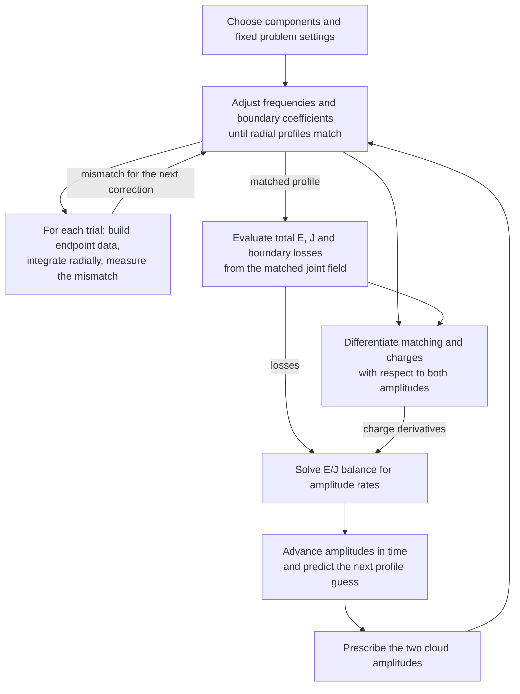
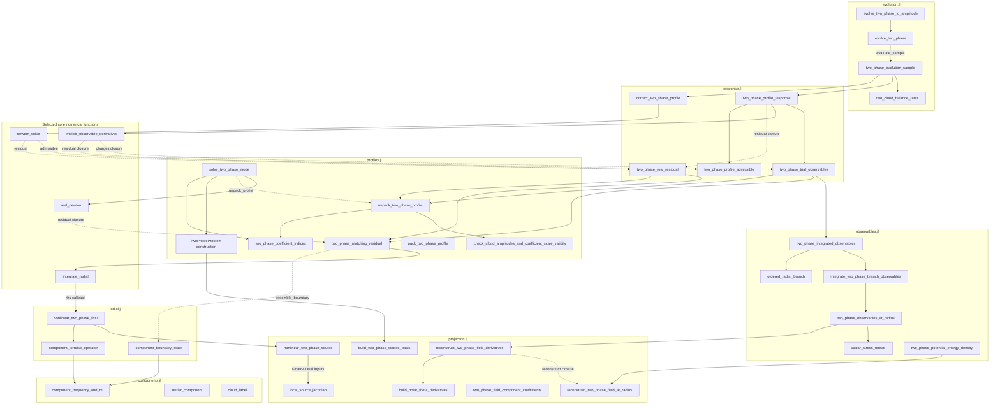

# Multiphase learning map

Use this checklist to understand how the joint two-cloud calculation fits
together, then work through its functions one at a time. It covers all 34
top-level functions and four structs in `src/adiabatic/multiphase/` as of
October 26, 2026. The diagrams describe the current implementation; the
[organization proposal](multiphase-profile-organization.md) records the
completed profile/coordinate migration and deferred interface changes.
[HANDOFF.md](../HANDOFF.md) records implementation progress.

Check a box when you can explain the function's inputs, output, role in the
calculation, and a useful check of its behavior. Write or revise its docstring
as part of that explanation. The boxes are yours to mark; passing tests alone
does not mark a function understood. Reading a function does not require
refactoring it.

## The calculation in view

Here arrows show the flow of the calculation. Energy $E$ and angular momentum
$J$ are the two charges used to determine the two amplitude rates.

Radial integration advances through space at fixed trial frequencies and
amplitudes. Amplitude evolution advances in time and repeatedly solves a new
radial matching problem. These are separate integration loops.

The current deliverable is the primary/secondary radial-profile overlay with
joint nonlinear deformation. Its next calculation follows the setup and
matching route. The charge, response, and evolution stages show the wider
project's calculation.

## Objects to recognize first

- [ ] `TwoPhaseSourceBasis` — fixed mode order, angular/phase basis matrix, quadrature weights, and squared polar nodes, built once and reused for source evaluations. It stores no radial coefficients or evaluated source. Defined in [projection.jl](../src/adiabatic/multiphase/projection.jl).
- [ ] `TwoPhaseProblem` — fixed background, components, quadrature, source basis, integration settings, coefficient scale, free indices, and reference boundary branches. Defined in [profiles.jl](../src/adiabatic/multiphase/profiles.jl).
- [ ] `TwoPhaseProfile` — two complex frequencies and physical boundary coefficients for a trial or matched profile; sampled radial functions are produced by integration. Defined in [profiles.jl](../src/adiabatic/multiphase/profiles.jl).
- [ ] `TwoPhaseMatchedSolution` — packed state, prescribed amplitudes, and convergence diagnostics. Defined in [response.jl](../src/adiabatic/multiphase/response.jl); the current corrector still returns a named tuple with these fields.

The word `state` has two uses to distinguish while reading. Newton's state
contains frequencies and scaled free boundary data. A radial integrator's
state contains the sampled profiles $R$ and slopes $Q=dR/dr_*$ at one radius,
where $r_*$ is tortoise radius. Packing a Newton state does not produce radial
samples.

## Function checklist in reading order

The groups follow the calculation's ingredients. We have been discussing the
precomputed source basis, matrix source evaluation, and local Jacobian in
group 3. The specialized derivative method and Newton options are now present.
The assistant's driver additions were removed at the user's request; resume
toward another convergence test one reviewed block at a time.
The radial-matching walkthrough below remains a guide for
returning to group 4.

### 1 Labels and retained components

Source: [components.jl](../src/adiabatic/multiphase/components.jl).
Check: [test_components.jl](../tests/adiabatic/multiphase/test_components.jl).

- [X] `cloud_label` — record a cloud's linear-limit quantum numbers.
- [X] `fourier_component` — define a retained phase combination and its angular harmonics.
- [X] `component_frequency_and_m` — calculate a component's frequency and azimuthal number from its phase label and the independent clouds.

### 2 Physical profiles and solver coordinates

Source: [profiles.jl](../src/adiabatic/multiphase/profiles.jl).
Check: [test_response_coordinates.jl](../tests/adiabatic/multiphase/test_response_coordinates.jl).

- [X] `two_phase_coefficient_indices` — locate prescribed outer coefficients in cloud order and the remaining free coefficients in flattened mode order.
- [X] `check_cloud_amplitudes_and_coefficient_scale_validity` — validate the two prescribed amplitudes and fixed numerical scale.
- [X] `pack_two_phase_profile` — select unknowns, scale boundary coefficients, and pack real parts followed by imaginary parts.
- [X] `unpack_two_phase_profile` — unpack real solver coordinates into a physical `TwoPhaseProfile`, restoring coefficient scale and inserting prescribed amplitudes.

### 3 Reconstructing the field and its nonlinear source

Source: [projection.jl](../src/adiabatic/multiphase/projection.jl).
Checks: [test_phase_separation.jl](../tests/adiabatic/multiphase/test_phase_separation.jl),
[test_nonlinear_source.jl](../tests/adiabatic/multiphase/test_nonlinear_source.jl),
[test_source_basis.jl](../tests/adiabatic/multiphase/test_source_basis.jl),
and [test_source_validation.jl](../tests/adiabatic/multiphase/test_source_validation.jl).

- [X] `reconstruct_two_phase_field_at_radius` — reconstruct the joint real field on polar and phase nodes at one radius.
- [X] `two_phase_field_component_coefficients` — extract requested angular and phase coefficients from a sampled field.
- [ ] `build_two_phase_source_basis` — precompute the angular/phase patterns and quadrature data in the retained mode order.
- [X] `nonlinear_two_phase_source` — reconstruct the joint field, evaluate its nonlinear remainder, and project onto the modes in the required source basis; inputs and outputs are packed real vectors.
- [ ] `local_source_jacobian` — return the source and its derivatives with respect to the packed radial coefficients, radius, spin, and coupling, holding the source basis fixed.

By default, `TwoPhaseProblem` calls `build_two_phase_source_basis` once at construction.
The resulting `TwoPhaseSourceBasis` stores the mode labels, basis matrix,
quadrature weights, and squared polar nodes. Radial integration reuses it;
the source function reconstructs and projects with matrix products. The
general reconstruction and projection functions above remain available for
diagnostics and the direct-quadrature test reference. `local_source_jacobian`
calculates derivatives at one radius; the specialized ForwardDiff source
method now uses it to propagate incoming derivatives.

The source interface is now
`nonlinear_two_phase_source(parameters, source_basis; potential=:cosine)`.
For `n` modes, `parameters` holds `n` real coefficient parts, `n` imaginary
parts, then radius, spin, and coupling. The output has `2n` real entries in
the same coefficient order. Include every mode to be projected onto in the
basis, assigning zero input coefficients to modes absent from the trial field.
There is one source implementation, with no dictionary method or uncached
fallback.

`local_source_jacobian` differentiates source coefficients with respect to
these local inputs. `reconstruct_two_phase_field_derivatives` in group 5
instead takes spacetime derivatives of the reconstructed field for the stress
tensor. Ordinary source evaluation uses the matrix calculation directly;
the `Dual{Tag,Float64,N}` method uses the explicit local Jacobian and applies
the chain rule. Other numeric types retain the generic matrix calculation.

### 4 Radial equations and matching a trial

Sources: [radial.jl](../src/adiabatic/multiphase/radial.jl) and
[profiles.jl](../src/adiabatic/multiphase/profiles.jl).
Checks: [test_radial_operator.jl](../tests/adiabatic/multiphase/test_radial_operator.jl),
[test_nonlinear_rhs.jl](../tests/adiabatic/multiphase/test_nonlinear_rhs.jl),
[test_matching_residual.jl](../tests/adiabatic/multiphase/test_matching_residual.jl),
and [test_nonlinear_matching.jl](../tests/adiabatic/multiphase/test_nonlinear_matching.jl).

- [ ] `component_tortoise_operator` — assemble one component's linear radial operator, including mixing between its angular harmonics.
- [ ] `component_boundary_state` — turn leading boundary coefficients into endpoint values and tortoise slopes.
- [ ] `nonlinear_two_phase_rhs!` — combine linear operators and the joint nonlinear source using the required source basis; verify mode order and fill the radial derivatives.
- [X] `two_phase_matching_residual` — integrate from both boundaries and compare at the matching radius; optionally return both radial histories.
- [ ] `solve_two_phase_mode` — solve matching at two prescribed amplitudes using the standalone complex-coordinate interface to real Newton iteration.

Read the existing [radial RK4 design](multiphase-rk4-design.md) for the four
stages inside each radial step. Its October 15 file-location notes predate the
move of the radial functions to `radial.jl`.

### 5 Charges and boundary fluxes

Sources: [projection.jl](../src/adiabatic/multiphase/projection.jl) and
[observables.jl](../src/adiabatic/multiphase/observables.jl).
Checks: [test_field_derivatives.jl](../tests/adiabatic/multiphase/test_field_derivatives.jl),
[test_stress_tensor.jl](../tests/adiabatic/multiphase/test_stress_tensor.jl),
[test_potential_energy.jl](../tests/adiabatic/multiphase/test_potential_energy.jl),
[test_observables_at_radius.jl](../tests/adiabatic/multiphase/test_observables_at_radius.jl),
and [test_integrated_observables.jl](../tests/adiabatic/multiphase/test_integrated_observables.jl).

- [ ] `build_polar_theta_derivatives` — build polar-basis derivatives with respect to the polar angle.
- [ ] `reconstruct_two_phase_field_derivatives` — reconstruct the field and its four coordinate derivatives using real carrier frequencies and fixed profiles.
- [ ] `scalar_stress_tensor` — evaluate one scalar field's stress tensor at one sample point.
- [ ] `two_phase_potential_energy_density` — evaluate the potential-only radial energy density as a separate diagnostic.
- [ ] `two_phase_observables_at_radius` — average the stress tensor to obtain charge densities and signed radial currents.
- [ ] `ordered_radial_branch` — validate and orient one saved radial history toward increasing radius.
- [ ] `integrate_two_phase_branch_observables` — integrate the charge densities over one prepared history and retain endpoint currents.
- [ ] `two_phase_integrated_observables` — combine both histories and turn endpoint currents into signed boundary losses.

### 6 Correction and response to changing amplitudes

Source: [response.jl](../src/adiabatic/multiphase/response.jl).
The [campaign record](../runs/adiabatic/multiphase_two_cloud/README.md) describes
neighboring-amplitude checks of response derivatives on preserved source.

- [ ] `two_phase_profile_admissible` — check finite packed coordinates, fundamental frequency bounds, and component branch classification.
- [ ] `two_phase_real_residual` — real-pack and scale the matching mismatch for Newton and differentiation.
- [ ] `correct_two_phase_profile` — correct a packed guess at prescribed amplitudes with a ForwardDiff Jacobian.
- [ ] `two_phase_trial_observables` — obtain radial histories and evaluate charges and losses using the real parts of the trial frequencies.
- [ ] `two_phase_profile_response` — differentiate matching implicitly, then include that profile response in both charge derivatives.

### 7 Amplitude evolution from charge balance

Source: [evolution.jl](../src/adiabatic/multiphase/evolution.jl).
Checks: [test_evolution.jl](../tests/adiabatic/multiphase/test_evolution.jl) and
[test_amplitude_target.jl](../tests/adiabatic/multiphase/test_amplitude_target.jl).
The handoff records an unresolved return-field mismatch in `test_evolution.jl`.

- [ ] `two_cloud_balance_rates` — solve the two balance equations for logarithmic amplitude rates, with scaling and conditioning diagnostics.
- [ ] `two_phase_evolution_sample` — combine a corrected profile, charge response, losses, and logarithmic amplitude rates at one pair of amplitudes.
- [ ] `evolve_two_phase` — take midpoint steps in logarithmic amplitudes, correcting profiles at each stage and tracking charge budgets.
- [ ] `evolve_two_phase_to_amplitude` — repeat steps until the primary amplitude reaches a target or another stopping condition applies.

## Function dependency diagram

Here arrows point from a caller to a function it uses, reversing the usual
direction of a data-flow arrow. Solid arrows denote direct calls; dashed
arrows denote calls through locally defined closures or supplied callbacks.
In particular, `evolve_two_phase` receives an `evaluate_sample` callback;
the campaign binds it to `two_phase_evolution_sample`.

All 34 multiphase functions appear below, grouped by source file. Selected
`core/` functions explain the numerical delegation; the table below supplies
other shared dependencies. Standard-library operations and output callbacks
are omitted. `TwoPhaseProblem` construction is shown because it builds the
source basis by default; other constructors and loader includes are omitted.

`cloud_label`, `fourier_component`, and `pack_two_phase_profile` have no
incoming library arrows because callers outside this folder use them for
setup. `two_phase_potential_energy_density` is a separate diagnostic; the
full observable calculation includes potential energy through
`scalar_stress_tensor`.

`two_phase_field_component_coefficients` has no incoming production arrows:
the projector supplies the direct-quadrature test reference. The conditional
source-to-Jacobian arrow denotes the specialized ForwardDiff method.
`nonlinear_two_phase_source` performs
reconstruction and projection directly with the stored matrix, so it has no
call arrows to the general reconstruction/projector functions.

The two correction routes currently coexist. `solve_two_phase_mode` accepts
separate physical guesses and settings, and calls `real_newton` with complex
candidates. `correct_two_phase_profile` accepts a problem and real-packed
guess, and calls `newton_solve` with a ForwardDiff Jacobian. Both reach
`two_phase_matching_residual`. The diagram omits the standalone solver's
local `admissible` function; it does not call `two_phase_profile_admissible`.

## Shared functions to follow when needed

These live outside `multiphase/`; follow them when they explain the current
function, rather than expanding the reading list all at once.

| Shared source | Functions used here | Role |
|---|---|---|
| [core/newton.jl](../src/adiabatic/core/newton.jl) | `pack_complex`, `unpack_complex`, `real_newton`, `newton_solve` | Real/complex coordinates and Newton corrections |
| [core/integration.jl](../src/adiabatic/core/integration.jl) | `integrate_radial` | Synchronized radial RK4 steps |
| [core/sensitivity.jl](../src/adiabatic/core/sensitivity.jl) | `implicit_observable_derivatives` | Derivatives of the matched state and observables |
| [core/geometry.jl](../src/adiabatic/core/geometry.jl) | `tortoise_geometry`, `kerr_metric` | Radial coordinate conversion and background metric |
| [core/radial_operator.jl](../src/adiabatic/core/radial_operator.jl) | `tortoise_operator_coefficients` | Scalar coefficients of the linear radial equation |
| [core/boundaries.jl](../src/adiabatic/core/boundaries.jl) | `horizon_boundary_data`, `outer_boundary_data` | Endpoint asymptotic series |
| [core/potentials.jl](../src/adiabatic/core/potentials.jl) | `potential_remainder`, `potential_value` | Nonlinear source and stress-tensor potential |
| [core/quadrature.jl](../src/adiabatic/core/quadrature.jl) | `integrate_uniform` | Radial integration of charge densities |

[`load.jl`](../src/adiabatic/multiphase/load.jl) defines no functions. It loads
`core/`, then components, projection, radial, profiles, observables, response,
and evolution once into the calling module. Projection now precedes radial
and profiles so `TwoPhaseSourceBasis` exists when their type annotations are
evaluated. Include order is distinct from call order: function bodies can
refer to functions defined by a later include, but signature types must
already be defined.

## Current place to resume

**Important architecture follow-up:** the user wants to revisit the source,
Jacobian, and differentiation adapter together to prevent bloat. The next
convergence test remains the immediate priority. See the persistent
[architecture-review note](../HANDOFF.md#important-revisit-multiphase-architecture).

Updated October 26: the library changes remain, but the assistant's driver
additions were rolled back. The user subsequently added the reviewed one-line
full-width batching option; v5 job 27304701 exhausted 12 corrections at
scaled residual 1.49475e8 and saved no joint solution. Continue
walking through each block. Existing understanding checkboxes are
preserved. The new basis type, builder, and local-Jacobian entries start
unchecked for your review; implementation and tests do not mark them understood.

The profile-coordinate migration is complete for this pass. Packing and
unpacking use `TwoPhaseProfile` and `TwoPhaseProblem`; physical matching takes
those objects directly. Both solver routes use the common unpacker, and the
live driver uses the shared coefficient-index helper. The old tuple unpacker
and packed matching wrapper are removed. The corrected driver passes its
already-packed guess directly to the admissibility check.

The source basis is now required and connected through radial integration,
matching, and response calculations. `TwoPhaseProblem` builds it once by
default and reuses it while mode order and angular/phase settings remain fixed.
`local_source_jacobian` returns the source and its `2n` by `(2n + 3)` derivative
matrix for `n` retained modes. The specialized source method applying this
matrix to incoming ForwardDiff directions has now been added.
Newton exposes chunk-size and accepted-state callback options; the driver now
uses full-width batching, but does not save accepted iterates.
Job 27296945 timed the full-domain Jacobian at 92.51 s,
but stopped before Newton on a directional-derivative discrepancy. See the
[current handoff](../HANDOFF.md#resume-here-direct-mutual-deformation-profiles-and-source-optimization-october-26)
before choosing the next run; do not reintroduce driver machinery without
walking through it with the user.

During the October 26 basis integration, 388 checks passed through source,
radial integration, Newton matching, observables, and profile coordinates.
The broader suite then stopped on two existing evolution-test errors:
`test_evolution.jl` expects `amplitude_rates`, but `two_cloud_balance_rates`
returns `log_rates`. After the source-basis rename, 147 focused source,
radial, matching, and profile-coordinate checks passed again. These are
algorithm/interface checks; full-domain runtime and physical spatial
convergence remain unverified. No new production solve was submitted.
See the handoff for the unresolved response-versus-standalone admissibility
rules and the evolution return-field mismatch.

### Radial-matching walkthrough to return to

Start with a `TwoPhaseProfile` and fixed `TwoPhaseProblem`. The profile contains
two trial frequencies and physical coefficients at both boundaries; any
prescribed outer amplitudes have already been inserted during unpacking.
The problem already holds the source basis built from its fixed mode order
and angular/phase grids.
One matching evaluation follows this route:

1. **Build endpoint states.** The local `assemble_boundary` closure in
   `two_phase_matching_residual` slices the coefficient arrays by component.
   `component_boundary_state` calculates that component's frequency and m,
   evaluates the appropriate linear asymptotic series at the finite endpoint,
   and returns its `[R; Q]` block, with `Q = dR/dr_*`. Leading coefficients
   specify the series; they are not the endpoint field values themselves.
2. **Arrange the joint state.** Gather every component's R entries, then every
   component's Q entries. For components with `l_values=[1,3]` and `[2]`, this
   is `[R₁₁, R₃₁, R₂₂, Q₁₁, Q₃₁, Q₂₂]`, where the subscripts here denote
   `(l,m)` and the components are the two fundamentals with `cloud_m=[1,2]`.
3. **Integrate both branches.** `integrate_radial` advances from `inner` to
   `match` and from `outer` to `match`, all in tortoise radius. Each RK4 stage
   calls `nonlinear_two_phase_rhs!` on the full joint state. Frequencies remain
   fixed during these integrations. The linear operator mixes angular entries
   within one component; the nonlinear source is reconstructed from all of them
   using the same source basis at every stage.
4. **Compare at the match.** Return `[R_from_horizon-R_from_outer;
   Q_from_horizon-Q_from_outer]` in the same flattened mode order. With N
   retained radial modes, this is 2N complex mismatches. A trial need not match;
   Newton changes its frequencies and free coefficients to reduce this vector.
   The physical matching function does not apply `coefficient_scale`.
5. **Optionally keep the histories.** `save_radial_result=true` returns
   `from_horizon`, `from_outer`, and `residual`. Both histories end at `match`,
   but the outer history runs toward decreasing radius. Both matching-point
   states are retained, including any residual mismatch.

When returning to the boundary helpers, start with `component_boundary_state` in
[radial.jl](../src/adiabatic/multiphase/radial.jl). Follow its horizon/outer
helpers in [core/boundaries.jl](../src/adiabatic/core/boundaries.jl) as needed.
A useful checkpoint is that doubling a component's leading coefficients at
fixed frequency doubles its boundary R and Q: these endpoint series are linear,
even though the subsequent radial integration includes nonlinear interactions.

The existing [matching checks](../tests/adiabatic/multiphase/test_matching_residual.jl)
exercise unequal angular-block ordering, agreement between saved and plain
residuals, the single-cloud limit, and radial RK4 refinement. They provide
numerical checks to accompany the explanation; they do not mark a helper
understood. Boundary-assembly cleanup and adopting the matched-result type
remain deferred. The understanding checkboxes above remain yours to mark.
