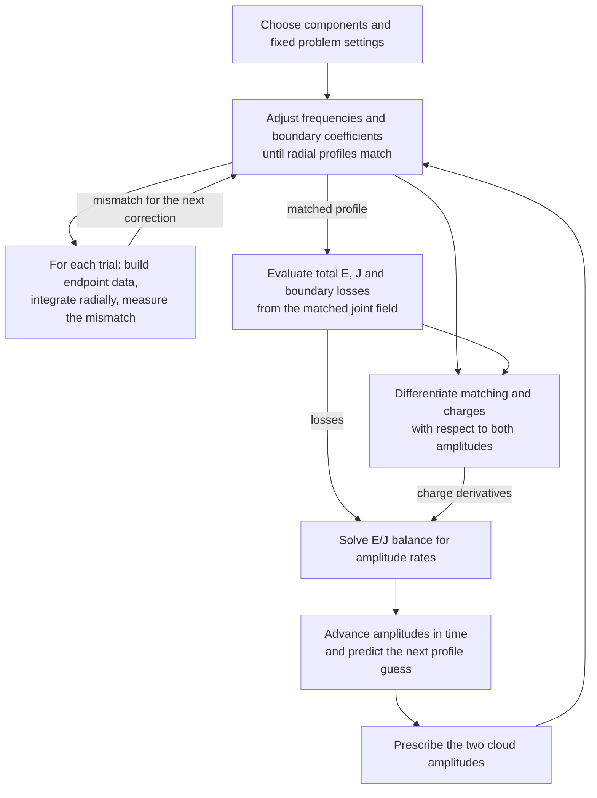

# Multiphase learning map

Use this checklist to understand how the joint two-cloud calculation fits
together, then work through its functions one at a time. It covers all 32
top-level functions and three structs in `src/adiabatic/multiphase/` as of
October 21, 2026. The diagrams describe the current implementation; the
[organization proposal](multiphase-profile-organization.md) describes later
interface changes. [HANDOFF.md](../HANDOFF.md) records implementation progress.

Check a box when you can explain the function's inputs, output, role in the
calculation, and a useful check of its behavior. Write or revise its docstring
as part of that explanation. The boxes are yours to mark; passing tests alone
does not mark a function understood. Reading a function does not require
refactoring it.

## The calculation in view

Here arrows show the flow of the calculation. Energy $E$ and angular momentum
$J$ are the two charges used to determine the two amplitude rates.

Radial integration advances through space at fixed trial frequencies and
amplitudes. Amplitude evolution advances in time and repeatedly solves a new
radial matching problem. These are separate integration loops.

## Objects to recognize first

- [ ] `TwoPhaseProblem` — fixed background, components, quadrature, integration settings, coefficient scale, free indices, and reference boundary branches. Defined in [profiles.jl](../src/adiabatic/multiphase/profiles.jl).
- [ ] `TwoPhaseProfile` — two complex frequencies and physical boundary coefficients for a trial or matched profile; sampled radial functions are produced by integration. Defined in [profiles.jl](../src/adiabatic/multiphase/profiles.jl).
- [ ] `TwoPhaseMatchedSolution` — packed state, prescribed amplitudes, and convergence diagnostics. Defined in [response.jl](../src/adiabatic/multiphase/response.jl); the current corrector still returns a named tuple with these fields.

The word `state` has two uses to distinguish while reading. Newton's state
contains frequencies and scaled free boundary data. A radial integrator's
state contains the sampled profiles $R$ and slopes $Q=dR/dr_*$ at one radius,
where $r_*$ is tortoise radius. Packing a Newton state does not produce radial
samples.

## Function checklist in reading order

The groups follow the calculation's ingredients. Start with the current
coordinate cleanup in group 2, then trace one trial through groups 3 and 4.
Return to group 1 whenever a component label needs clarification.

### 1 Labels and retained components

Source: [components.jl](../src/adiabatic/multiphase/components.jl).
Check: [test_components.jl](../tests/adiabatic/multiphase/test_components.jl).

- [ ] `cloud_label` — record a cloud's linear-limit quantum numbers.
- [ ] `fourier_component` — define a retained phase combination and its angular harmonics.
- [ ] `component_frequency_and_m` — calculate a component's frequency and azimuthal number from its phase label and the independent clouds.

### 2 Physical profiles and solver coordinates

Source: [profiles.jl](../src/adiabatic/multiphase/profiles.jl).
Check: [test_response_coordinates.jl](../tests/adiabatic/multiphase/test_response_coordinates.jl).

- ~~[X] `two_phase_coefficient_indices` — locate prescribed outer coefficients in cloud order and the remaining free coefficients in flattened mode order.~~
- ~~[X] `check_cloud_amplitudes_and_coefficient_scale_validity` — validate the two prescribed amplitudes and fixed numerical scale.~~
- [] `pack_two_phase_profile` — select unknowns, scale boundary coefficients, and pack real parts followed by imaginary parts.
- [ ] `unpack_two_phase_profile` — unpack real solver coordinates into a physical `TwoPhaseProfile`, restoring coefficient scale and inserting prescribed amplitudes.

### 3 Reconstructing the field and its nonlinear source

Source: [projection.jl](../src/adiabatic/multiphase/projection.jl).
Checks: [test_phase_separation.jl](../tests/adiabatic/multiphase/test_phase_separation.jl),
[test_nonlinear_source.jl](../tests/adiabatic/multiphase/test_nonlinear_source.jl),
and [test_source_validation.jl](../tests/adiabatic/multiphase/test_source_validation.jl).

- [ ] `reconstruct_two_phase_field_at_radii` — reconstruct the joint real field on polar and phase nodes at one radius, despite the plural name.
- [ ] `project_two_phase_field` — extract requested angular and phase coefficients from a sampled field.
- [ ] `nonlinear_two_phase_source` — evaluate the nonlinear remainder of the joint field and project it onto retained or requested components.

### 4 Radial equations and matching a trial

Sources: [radial.jl](../src/adiabatic/multiphase/radial.jl) and
[profiles.jl](../src/adiabatic/multiphase/profiles.jl).
Checks: [test_radial_operator.jl](../tests/adiabatic/multiphase/test_radial_operator.jl),
[test_nonlinear_rhs.jl](../tests/adiabatic/multiphase/test_nonlinear_rhs.jl),
[test_matching_residual.jl](../tests/adiabatic/multiphase/test_matching_residual.jl),
and [test_nonlinear_matching.jl](../tests/adiabatic/multiphase/test_nonlinear_matching.jl).

- [ ] `component_tortoise_operator` — assemble one component's linear radial operator, including mixing between its angular harmonics.
- [ ] `component_boundary_state` — turn leading boundary coefficients into endpoint values and tortoise slopes.
- [ ] `nonlinear_two_phase_rhs!` — combine linear operators and the joint nonlinear source to fill the radial derivatives.
- [ ] `two_phase_matching_residual` — integrate from both boundaries and compare at the matching radius; optionally return both radial histories.
- [ ] `solve_two_phase_mode` — solve matching at two prescribed amplitudes using the standalone complex-coordinate interface to real Newton iteration.

Read the existing [radial RK4 design](multiphase-rk4-design.md) for the four
stages inside each radial step. Its October 15 file-location notes predate the
move of the radial functions to `radial.jl`.

### 5 Charges and boundary fluxes

Sources: [projection.jl](../src/adiabatic/multiphase/projection.jl) and
[observables.jl](../src/adiabatic/multiphase/observables.jl).
Checks: [test_field_derivatives.jl](../tests/adiabatic/multiphase/test_field_derivatives.jl),
[test_stress_tensor.jl](../tests/adiabatic/multiphase/test_stress_tensor.jl),
[test_potential_energy.jl](../tests/adiabatic/multiphase/test_potential_energy.jl),
[test_observables_at_radius.jl](../tests/adiabatic/multiphase/test_observables_at_radius.jl),
and [test_integrated_observables.jl](../tests/adiabatic/multiphase/test_integrated_observables.jl).

- [ ] `build_polar_theta_derivatives` — build polar-basis derivatives with respect to the polar angle.
- [ ] `reconstruct_two_phase_field_derivatives` — reconstruct the field and its four coordinate derivatives using real carrier frequencies and fixed profiles.
- [ ] `scalar_stress_tensor` — evaluate one scalar field's stress tensor at one sample point.
- [ ] `two_phase_potential_energy_density` — evaluate the potential-only radial energy density as a separate diagnostic.
- [ ] `two_phase_observables_at_radius` — average the stress tensor to obtain charge densities and signed radial currents.
- [ ] `ordered_radial_branch` — validate and orient one saved radial history toward increasing radius.
- [ ] `integrate_two_phase_branch_observables` — integrate the charge densities over one prepared history and retain endpoint currents.
- [ ] `two_phase_integrated_observables` — combine both histories and turn endpoint currents into signed boundary losses.

### 6 Correction and response to changing amplitudes

Source: [response.jl](../src/adiabatic/multiphase/response.jl).
The [campaign record](../runs/adiabatic/multiphase_two_cloud/README.md) describes
neighboring-amplitude checks of response derivatives on preserved source.

- [ ] `two_phase_profile_admissible` — check finite packed coordinates, fundamental frequency bounds, and component branch classification.
- [ ] `two_phase_real_residual` — real-pack and scale the matching mismatch for Newton and differentiation.
- [ ] `correct_two_phase_profile` — correct a packed guess at prescribed amplitudes with a ForwardDiff Jacobian.
- [ ] `two_phase_trial_observables` — obtain radial histories and evaluate charges and losses using the real parts of the trial frequencies.
- [ ] `two_phase_profile_response` — differentiate matching implicitly, then include that profile response in both charge derivatives.

### 7 Amplitude evolution from charge balance

Source: [evolution.jl](../src/adiabatic/multiphase/evolution.jl).
Checks: [test_evolution.jl](../tests/adiabatic/multiphase/test_evolution.jl) and
[test_amplitude_target.jl](../tests/adiabatic/multiphase/test_amplitude_target.jl).
The handoff records an unresolved return-field mismatch in `test_evolution.jl`.

- [ ] `two_cloud_balance_rates` — solve the two balance equations for logarithmic amplitude rates, with scaling and conditioning diagnostics.
- [ ] `two_phase_evolution_sample` — combine a corrected profile, charge response, losses, and amplitude rates at one pair of amplitudes.
- [ ] `evolve_two_phase` — take midpoint steps in logarithmic amplitudes, correcting profiles at each stage and tracking charge budgets.
- [ ] `evolve_two_phase_to_amplitude` — repeat steps until the primary amplitude reaches a target or another stopping condition applies.

## Function dependency diagram

Here arrows point from a caller to a function it uses, reversing the usual
direction of a data-flow arrow. Solid arrows denote direct calls; dashed
arrows denote calls through locally defined closures or supplied callbacks.
In particular, `evolve_two_phase` receives an `evaluate_sample` callback;
the campaign binds it to `two_phase_evolution_sample`.

All 32 multiphase functions appear below, grouped by source file. Selected
`core/` functions explain the numerical delegation; the table below supplies
other shared dependencies. Standard-library operations and output callbacks
are omitted. Constructors and loader includes are separate from this call map.

```mermaid
flowchart TD
    subgraph evolution["evolution.jl"]
        target["evolve_two_phase_to_amplitude"]
        evolve["evolve_two_phase"]
        sample["two_phase_evolution_sample"]
        balance["two_cloud_balance_rates"]
    end
    subgraph response["response.jl"]
        correct["correct_two_phase_profile"]
        admissible["two_phase_profile_admissible"]
        realres["two_phase_real_residual"]
        trialobs["two_phase_trial_observables"]
        sensitivity["two_phase_profile_response"]
    end
    subgraph profiles["profiles.jl"]
        indices["two_phase_coefficient_indices"]
        validate["check_cloud_amplitudes_and_coefficient_scale_validity"]
        pack["pack_two_phase_profile"]
        unpack["unpack_two_phase_profile"]
        matching["two_phase_matching_residual"]
        solve["solve_two_phase_mode"]
    end
    subgraph radial["radial.jl"]
        boundary["component_boundary_state"]
        rhs["nonlinear_two_phase_rhs!"]
        operator["component_tortoise_operator"]
    end
    subgraph projection["projection.jl"]
        source["nonlinear_two_phase_source"]
        reconstruct["reconstruct_two_phase_field_at_radii"]
        project["project_two_phase_field"]
        polar["build_polar_theta_derivatives"]
        derivatives["reconstruct_two_phase_field_derivatives"]
    end
    subgraph observables["observables.jl"]
        total["two_phase_integrated_observables"]
        ordered["ordered_radial_branch"]
        branch["integrate_two_phase_branch_observables"]
        localobs["two_phase_observables_at_radius"]
        stress["scalar_stress_tensor"]
        potential["two_phase_potential_energy_density"]
    end
    subgraph components["components.jl"]
        numbers["component_frequency_and_m"]
        component["fourier_component"]
        cloud["cloud_label"]
    end
    subgraph core["Selected core numerical functions"]
        newton["newton_solve"]
        realnewton["real_newton"]
        implicit["implicit_observable_derivatives"]
        integrate["integrate_radial"]
    end

    target --> evolve
    evolve -. evaluate_sample .-> sample
    sample --> correct
    sample --> sensitivity
    sample --> balance
    correct --> newton
    newton -. residual .-> realres
    newton -. admissible .-> admissible
    sensitivity --> admissible
    sensitivity -. residual closure .-> realres
    sensitivity --> implicit
    sensitivity --> trialobs
    implicit -. residual closure .-> realres
    implicit -. charges closure .-> trialobs
    realres --> unpack
    realres --> matching
    trialobs --> unpack
    trialobs --> matching
    trialobs --> total
    unpack --> indices
    unpack --> validate
    solve --> indices
    solve -. unpack_profile .-> unpack
    solve --> realnewton
    realnewton -. residual closure .-> matching
    matching --> boundary
    matching --> integrate
    integrate -. rhs callback .-> rhs
    rhs --> operator
    rhs --> source
    operator --> numbers
    boundary --> numbers
    source --> reconstruct
    source --> project
    total --> ordered
    total --> branch
    branch --> localobs
    localobs --> derivatives
    localobs --> stress
    derivatives --> polar
    derivatives -. reconstruct closure .-> reconstruct
    potential --> reconstruct
```

`cloud_label`, `fourier_component`, and `pack_two_phase_profile` have no
incoming library arrows because callers outside this folder use them for
setup. `two_phase_potential_energy_density` is a separate diagnostic; the
full observable calculation includes potential energy through
`scalar_stress_tensor`.

The two correction routes currently coexist. `solve_two_phase_mode` accepts
separate physical guesses and settings, and calls `real_newton` with complex
candidates. `correct_two_phase_profile` accepts a problem and real-packed
guess, and calls `newton_solve` with a ForwardDiff Jacobian. Both reach
`two_phase_matching_residual`. The diagram omits the standalone solver's
local `admissible` function; it does not call `two_phase_profile_admissible`.

## Shared functions to follow when needed

These live outside `multiphase/`; follow them when they explain the current
function, rather than expanding the reading list all at once.

| Shared source | Functions used here | Role |
|---|---|---|
| [core/newton.jl](../src/adiabatic/core/newton.jl) | `pack_complex`, `unpack_complex`, `real_newton`, `newton_solve` | Real/complex coordinates and Newton corrections |
| [core/integration.jl](../src/adiabatic/core/integration.jl) | `integrate_radial` | Synchronized radial RK4 steps |
| [core/sensitivity.jl](../src/adiabatic/core/sensitivity.jl) | `implicit_observable_derivatives` | Derivatives of the matched state and observables |
| [core/geometry.jl](../src/adiabatic/core/geometry.jl) | `tortoise_geometry`, `kerr_metric` | Radial coordinate conversion and background metric |
| [core/radial_operator.jl](../src/adiabatic/core/radial_operator.jl) | `tortoise_operator_coefficients` | Scalar coefficients of the linear radial equation |
| [core/boundaries.jl](../src/adiabatic/core/boundaries.jl) | `horizon_boundary_data`, `outer_boundary_data` | Endpoint asymptotic series |
| [core/potentials.jl](../src/adiabatic/core/potentials.jl) | `potential_remainder`, `potential_value` | Nonlinear source and stress-tensor potential |
| [core/quadrature.jl](../src/adiabatic/core/quadrature.jl) | `integrate_uniform` | Radial integration of charge densities |

[`load.jl`](../src/adiabatic/multiphase/load.jl) defines no functions. It loads
`core/`, then components, radial, profiles, projection, observables, response,
and evolution once into the calling module. Include order is distinct from
call order: function bodies can refer to functions defined by a later include.

## Current place to resume

The profile-coordinate migration is complete for this pass. Packing and
unpacking use `TwoPhaseProfile` and `TwoPhaseProblem`; physical matching takes
those objects directly. Both solver routes use the common unpacker, and the
live driver uses the shared coefficient-index helper. The old tuple unpacker
and packed matching wrapper are removed. The corrected driver passes its
already-packed guess directly to the admissibility check.

All 97 focused coordinate, physical matching, and integrated-observables
checks passed after cleanup; the preceding standalone-solver migration passed
20 nonlinear matching checks. See the handoff for the validation limits and
remaining unrelated evolution-test mismatch.

Continue the docstring walkthrough by tracing a trial through boundary
construction, radial integration, and the matching mismatch. Boundary-assembly
cleanup and adopting the matched-result type are deferred. The understanding
checkboxes above remain yours to mark.
