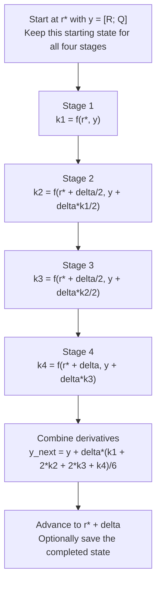
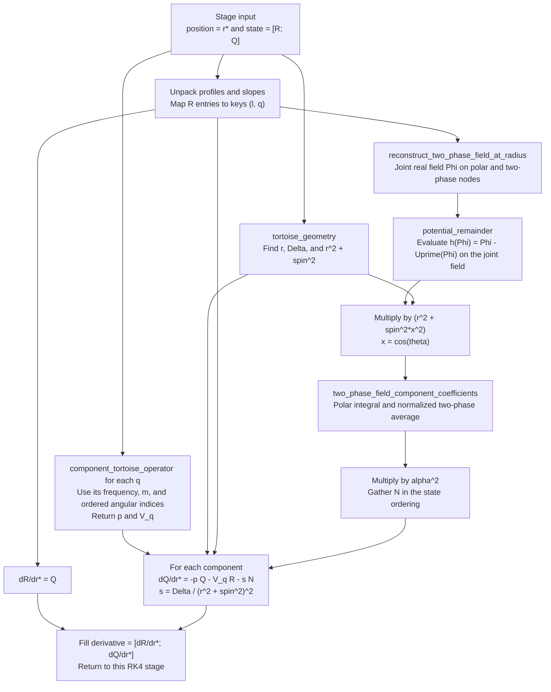

# Multiphase radial RK4 design

One radial Runge–Kutta step advances all retained Fourier components together
from tortoise radius $r_*$ to $r_*+\delta$. At each of its four stages, the
stage profiles reconstruct one joint real field, whose nonlinear remainder
couples the components. The carrier frequencies and cloud amplitudes defining
the profile problem are held fixed during this radial integration. Slow
evolution in physical time is a separate calculation.

The diagrams follow the style of the older
[Dolan control flow](DESIGN.md#5-control-flow). The equations and component
conventions come from the [multiphase implementation plan](multiphase-implementation-plan.md),
especially sections 2.1–2.3, 3.1–3.4, 3.6, and 3.8.

**Implementation status on October 15, 2026:** the shared radial integrator,
component operators, boundary wrapper, and two-phase nonlinear source exist.
The assembly called `nonlinear_two_phase_rhs!` below is implemented in
`multiphase/profiles.jl` and passes all 21 registered RHS checks against the
library. The matching residual is implemented and passes 24 registered checks,
including short radial integration and step refinement. The inserted Newton wrapper
passes 20 additional registered checks and converges a four-component trial;
all 159 multiphase checks pass against the library. Physical convergence and
the slow-growth profile formulation remain pending;
[HANDOFF.md](../HANDOFF.md) owns current status.

## State and component ordering

For the initial two-cloud model, a Fourier label is an integer pair
$\mathbf q=(q_1,q_2)$. Let $\omega_1,\omega_2$ be the two clouds' carrier
frequencies and $m_1,m_2$ their azimuthal integers. The component's frequency
and azimuthal integer are
$\Omega_{\mathbf q}=q_1\omega_1+q_2\omega_2$ and
$m_{\mathbf q}=q_1m_1+q_2m_2$. Each component retains its own ordered angular
indices $l\in L_{\mathbf q}$. Labels such as $(2,-1)$ describe driven
components while retaining the same two independent cloud phases.

Flatten the component list in its supplied order, then each component's
`l_values` in their supplied order. Let $n$ be the resulting number of
$(l,\mathbf q)$ pairs. The integrator holds a complex vector of length $2n$:

$$
\mathbf y=
\begin{pmatrix}\mathbf R\\\mathbf Q\end{pmatrix},
\qquad Q_{l,\mathbf q}=\frac{dR_{l,\mathbf q}}{dr_*}.
$$

All profiles occupy the first half; all tortoise slopes occupy the second.
For example, retaining one angular index for each of
$(1,0),(0,1),(2,-1),(-1,2)$ gives four profile entries and four slopes.
The number of independent phases is still two. Use the same flattened order
when unpacking the state, gathering projected sources, and writing derivatives.

For each component, the right-hand side (RHS) is

$$
\frac{d\mathbf R_{\mathbf q}}{dr_*}=\mathbf Q_{\mathbf q},
\qquad
\frac{d\mathbf Q_{\mathbf q}}{dr_*}
=-p\mathbf Q_{\mathbf q}-V_{\mathbf q}\mathbf R_{\mathbf q}
-s\mathbf N_{\mathbf q}.
$$

In units $M=1$, write $a$ for the code's `spin`, $\alpha=M\mu$ for the scalar
mass parameter, and $r$ for Boyer–Lindquist radius. Then

$$
\Delta=r^2-2r+a^2,\qquad
s=\frac{\Delta}{(r^2+a^2)^2},\qquad p=2rs.
$$

Here $V_{\mathbf q}$ is the linear angular matrix returned by
`component_tortoise_operator`; it includes the diagonal and off-diagonal
angular couplings. $\mathbf N_{\mathbf q}$ is the projected nonlinear source
before multiplication by $-s$.

## One radial RK4 step

Write $\mathbf f(r_*,\mathbf y)$ for the complete RHS above. The signed
spacing $\delta$ is positive for outward integration and negative for inward
integration. Each $\mathbf k_i$ below is a derivative vector with the same
length and ordering as $\mathbf y$; the factor $\delta$ has not yet been
absorbed into it.

Every occurrence of `f` runs the complete RHS diagram below. In particular,
stages 2 and 3 share a radius but generally have different trial profiles and
different nonlinear sources. Reusing stage 2's source at stage 3 would change
the integration method. All components use the same stage state when forming
the joint source.

This sequence is already implemented in
[`integrate_radial`](../src/adiabatic/core/integration.jl). Its `rhs!` callback
has arguments `(derivative, state, position)`; a multiphase wrapper will bind
the fixed model inputs to the RHS. The callback fills `derivative`
without changing `state`. For a requested positive maximum `step`, the
integrator chooses enough equal signed spacings to land on `stop` exactly.

## Inside each RHS evaluation

The RHS receives one stage radius and one stage state. Linear operations act
within each component's angular block. The nonlinear source is formed from
the profiles of every retained component together.

The chain from field reconstruction through multiplication by $\alpha^2$ is
already packaged as `nonlinear_two_phase_source`. The RHS calls it
once per stage for all retained output pairs, then distributes the results
among the component blocks. The diagram shows data dependencies;
`component_tortoise_operator` currently evaluates geometry inside its own call.

To make the projection explicit, let $x=\cos\theta$ and
$\boldsymbol\psi=(\psi_1,\psi_2)$, where
$\psi_a=\vartheta_a-m_a\varphi$: $\vartheta_a$ is cloud $a$'s temporal phase
and $\varphi$ is the spatial azimuth. $Y_{l,|m|}(x)$ is the real polar basis
normalized to unit squared integral over $x\in[-1,1]$. The reconstruction is

$$
\Phi(x,\boldsymbol\psi)
=2\operatorname{Re}\sum_{(l,\mathbf q)}
R_{l,\mathbf q}Y_{l,|m_{\mathbf q}|}(x)
e^{-i\mathbf q\cdot\boldsymbol\psi}.
$$

Keep one representative per conjugate pair in this sum; reconstruction supplies
its conjugate. The current representation assumes nonzero phase labels.
All $R_{l,\mathbf q}$ in this expression come from the current RK4 stage.

For polar nodes $x_i$ with weights $w_i$ and uniform phase grids of sizes
$n_1,n_2$, the source is

$$
N_{l,\mathbf q}=\frac{\alpha^2}{n_1n_2}
\sum_{i,j,k} w_iY_{l,|m_{\mathbf q}|}(x_i)
e^{i(q_1\psi_{1,j}+q_2\psi_{2,k})}
(r^2+a^2x_i^2)h(\Phi_{ijk}).
$$

Here $U$ is the dimensionless potential excluding its overall $\alpha^2$,
and $h(\Phi)=\Phi-U'(\Phi)$ is `potential_remainder`: $\Phi-\sin\Phi$ for
cosine, $\Phi^3/6$ for quartic, and $\Phi^3/6-\Phi^5/120$ for sextic.
The polar geometric factor belongs inside the projection. The projection
uses the positive phase exponential and no extra factor of two; its phase
weights average over both full periods. Finally, the RHS applies the minus
sign and tortoise factor $s$ exactly once.

The phase nodes are quadrature coordinates held fixed across RK4 stages.
They sample the possible phases at one radius; this radial step does not
advance $\vartheta_a$ in physical time.

## Fixed inputs and work repeated at each stage

| Quantity | Lifetime during one radial integration |
|---|---|
| `spin`, `alpha`, potential choice, cloud frequencies and `cloud_m` | Fixed for this trial profile calculation |
| Components and flattened `(l, q)` ordering | Fixed; distinct phase labels remain separate even if their azimuthal integers agree |
| Polar values, polar weights, phase nodes, and cosine-squared coupling table | Build before integration and reuse; resolution follows plan section 3.6 |
| Stage profiles and slopes | Construct anew from the starting state and the preceding RK4 derivative |
| Geometry, $p$, and $V_{\mathbf q}$ | Evaluate at the stage radius; the two midpoint stages have equal geometric coefficients |
| Joint field, nonlinear remainder, and projected source | Recompute using every stage's trial profiles |

Near the horizon, use `tortoise_geometry` and the regularized
`tortoise_operator_coefficients` helpers. Obtain $s$ from
`geometry.delta / geometry.radial_factor^2`; forming a divergent intermediate
radial coefficient and multiplying it by a vanishing factor loses the
regularization described in plan section 2.2.

## Function map

| Operation | Source | Implementation plan |
|---|---|---|
| Component frequency and azimuthal integer | [`component_frequency_and_m`](../src/adiabatic/multiphase/components.jl) | 2 |
| Linear matrix and slope coefficient | [`component_tortoise_operator`](../src/adiabatic/multiphase/profiles.jl) | 2.2 |
| Endpoint profiles and slopes | [`component_boundary_state`](../src/adiabatic/multiphase/profiles.jl) | 2.3 |
| Real field reconstruction | [`reconstruct_two_phase_field_at_radius`](../src/adiabatic/multiphase/projection.jl) | 3.1 |
| Angular and phase projection | [`two_phase_field_component_coefficients`](../src/adiabatic/multiphase/projection.jl) | 3.2 and 3.6 |
| Complete joint nonlinear source | [`nonlinear_two_phase_source`](../src/adiabatic/multiphase/projection.jl) | 3.4 |
| Full derivative assembly | [`nonlinear_two_phase_rhs!`](../src/adiabatic/multiphase/profiles.jl) | 3.8, item 6 |
| Four-stage radial advance | [`integrate_radial`](../src/adiabatic/core/integration.jl) | Shared integrator for the radial equations in 2.2 and the planned matching in 4 |

## Boundary data and the surrounding profile solve

`component_boundary_state` supplies each component's endpoint vector
$[\mathbf R_{\mathbf q};\mathbf Q_{\mathbf q}]$. Pack these into the global
ordering by concatenating all profile blocks first and all slope blocks
second. Concatenating the complete per-component vectors directly would
interleave profiles and slopes incorrectly.

The planned matching solve integrates horizon data outward and outer data
inward to a common radius. Each integration repeatedly takes the RK4 step
above. Boundary series supply the initial data for each pass; they are not
reapplied at its intermediate stages. The matching residual compares both
profiles and slopes, and Newton corrections change the trial frequencies and
free boundary coefficients before another pair of integrations. The amplitude
normalizations and additional solvability conditions belong to plan
milestones 1 and 4.

The source projector can also request labels absent from the input field.
Those outputs diagnose omitted components. A component acquires an integrated
profile only when its profile and slope entries are included in the state.

The [RHS checks](../tests/adiabatic/multiphase/test_nonlinear_rhs.jl) now pass
against the library: single-cloud agreement, ordering, unchanged input state,
dimensions, and driven-source signs and scaling. Registered checks in
`test_matching_residual.jl` compare complete single-cloud integration histories
and refine radial spacing for a fixed joint initial state in both directions,
holding the retained components and quadrature fixed. They pass against
`two_phase_matching_residual` in the library.
Fourth-order convergence of that radial integration is a
separate check from polar/phase resolution and retained-component convergence.
