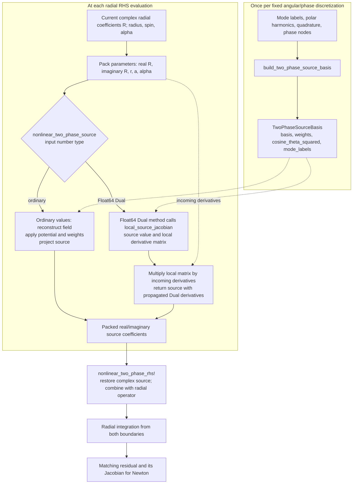

# Multiphase workplan — October 26, 2026

**Today's priority: understand the optimized source, run another direct Newton
convergence check, and prepare the three-model deformation comparison.** A
finished joint curve depends on obtaining a matched solution; submitting a job
is not the same as obtaining one.

**Later October 26 update:** direct job 27304701 exhausted 12 corrections at
scaled residual `1.49475e8`. After reviewing controls that isolate the enormous
inward mismatch to the finite-secondary joint guess, the user authorized a
weak-secondary solve, a Jacobian check at a matched seed, and subsequent small
amplitude continuation steps if those checks pass. This supersedes the direct
attempt's no-continuation constraint below. Job **27305905** tested the first
seed at 0.1% of the target secondary amplitude, with the primary fixed. It
reached `2.2742e-5` at the 12-correction cap, versus `1e-5` tolerance; no seed
was saved. Independent check **27306004** found ordinary/optimized AD agreement
of `7.48e-15` in its first direction, but finite-difference perturbations were
too large to establish local agreement. **Work stopped at the user's departure
request; both jobs finished and no ramp or retry is queued.** Resume with a
reviewed accepted-state save and modest iteration-cap change, and a better
scaled derivative check, before any amplitude ramp.
See the campaign README for its exact setup and outcome. Shared solver/library
changes still follow the tested-snippet workflow.

Work one reviewed block at a time. The user writes library changes from tested
snippets; driver changes also get explained before implementation. This plan
does not authorize rebuilding the removed preflight or checkpoint machinery.
Keep the architecture review in [HANDOFF.md](../HANDOFF.md#important-revisit-multiphase-architecture)
on the agenda after the next convergence attempt.

## 1. Design block diagram of the new projection code

The physics is still: reconstruct the **combined real field**, evaluate its
nonlinear potential term, and project that term back onto the retained modes.
Mutual deformation comes from applying the nonlinearity to the combined field;
it is not introduced by the optimization.

The two branches are methods of the **same existing function**, not two physical
models. The ordinary method is also the generic fallback for numeric types not
handled by the optimized Float64 Dual method. The basis contains fixed geometric
patterns, not cached field values; it is rebuilt when its defining mode order,
harmonics, or grids change.

For reading the code, define the following implementation notation:

- `c`: all real radial coefficients followed by all imaginary coefficients.
- `B`: `source_basis.basis`, mapping those coefficients to field samples.
- `W`: diagonal weights containing quadrature/phase averaging and
  `r^2 + a^2*cos(theta)^2`; `r` is Boyer–Lindquist radius and `a` is the code's
  spin parameter, with `M=1`.
- `h(Phi)`: `potential_remainder`; for the cosine potential, `Phi - sin(Phi)`.

Then the packed source `s` is

\[
\Phi=2Bc,\qquad s=\alpha^2 B^T W h(\Phi).
\]

The factor two accounts for conjugate modes in the real field. The radial RHS
applies the source's equation-of-motion minus sign and tortoise-coordinate
factor separately. The local coefficient derivative is

\[
\frac{\partial s}{\partial c}
=2\alpha^2 B^T W\,\operatorname{diag}(h'(\Phi))B.
\]

`local_source_jacobian` also differentiates with respect to `r`, `a`, and
`alpha`, including the implemented small-field branch of the potential helper.
For today's 14 radial modes, the dimensions clarify the separation:

| Object | Size | Meaning |
|---|---|---|
| `B` | 15376 × 28 | Fixed patterns on the 16 × 31 × 31 sample grid |
| Local parameter vector | 31 | 28 radial coefficients plus three background values |
| Local source Jacobian | 28 × 31 | Source response at one radius |
| Incoming derivatives, with full batching | 31 × 56 | Dependence of local parameters on Newton's unknowns |
| Propagated source derivatives | 28 × 56 | Local chain-rule result carried through integration |
| Full matching Jacobian | 56 × 56 | Boundary mismatch response after both integrations |

The local Jacobian is therefore **not** a replacement for the matching Jacobian.
It makes one repeatedly used part of its construction cheaper.

The older `reconstruct_two_phase_field_at_radius` and
`two_phase_field_component_coefficients` still supply diagnostic/reference
calculations. `reconstruct_two_phase_field_derivatives` supplies spacetime field
derivatives for stress-energy observables; those derivatives are different from
derivatives with respect to Newton's unknowns. They are not superseded by the
source basis. See [projection.jl](../src/adiabatic/multiphase/projection.jl)
and [radial.jl](../src/adiabatic/multiphase/radial.jl).

**First working block, about 15 minutes:** follow one source evaluation through
this diagram and the actual functions. Establish what is fixed, what changes at
each radial step, and what changes during differentiation before editing again.

## 2. Get to a new convergence check today

### Starting point and the smallest change

The library optimization and Newton's optional chunk-size/callback arguments
are present. The direct and submission drivers have been restored; there is no
live preflight script. The existing driver already logs trial/accepted residuals
and saves a converged solution and radial profiles.

Job **27296945** reproduced the previous initial residual,
`1.906482699496033e9`, in **14.63 s** and built the full-width Jacobian in
**92.51 s**. Its first finite-difference directional check reached only
`2.38e-4` relative agreement against the added `1e-5` threshold, so Newton never
started. This is an unresolved derivative-check discrepancy, not evidence that
Newton failed to converge. The old Jacobians took roughly 70 minutes.

| Order | Work | Concrete completion condition |
|---|---|---|
| 1 | Review one change to the existing `newton_solve` call in `logged_profile_newton`: `jacobian_chunk_size=length(initial)`. | We understand why all 56 directions can share one radial matching pass; no new wrapper or solver is introduced. |
| 2 | Apply that reviewed change and run a small, known-answer check of the driver call; run the existing setup-only check for the physical inputs. | Batching is actually forwarded, and the physical setup is unchanged. Budget about 10–15 minutes. |
| 3 | Freeze a fresh snapshot, proposed name `direct_fig7_20261026_v5`, and submit using the existing prepare/submit scripts. | A new job ID and frozen inputs are recorded. Never reuse or edit v4. Budget about 10 minutes excluding queue time. |
| 4 | Read the initial residual, first Jacobian timing, trial steps, and accepted corrections. | We distinguish derivative passes from Newton progress and record residual versus elapsed time. Check every 5–10 minutes while actively working. |
| 5 | Assess the outcome and preserve its evidence. | A converged state with independently recomputed matching residual, or a recorded failure/stall and one targeted next calculation. |

**Target: submit within roughly 30–45 minutes of starting these working blocks.**
Queue time and Newton convergence are not predictable from the first Jacobian
timing. Twelve Jacobians at 92.5 s would already take about 19 minutes; residual
evaluations, backtracking, compilation, and final profile integration add time.
The four-hour allocation remains a cap, not an estimate.

Keep the direct problem fixed: `alpha=0.3`, `spin=0.99`, the existing 14 modes,
16 × 31 × 31 quadrature, `r_*` from -100 to 300, match at 5, radial step 0.1,
boundary orders 3/7, scaled matching tolerance `1e-5`, and at most 12 corrections.
Keep both prescribed amplitudes and the reference initial guess unchanged.
No amplitude ramp is required for this direct diagnostic attempt.

### Handle the derivative discrepancy without rebuilding a preflight gate

The proposed next run is explicitly a **Newton convergence diagnostic**. It can
proceed while we investigate the derivative comparison: its progress and final
residual are evaluated with the ordinary source calculation. Successful matching
would not, by itself, validate the derivative implementation or spatial accuracy.

Use a separate, reviewed diagnostic, with heavy evaluations on Slurm. Start with
the single direction that failed: verify the perturbation scale and admissibility,
then compare the optimized directional derivative with ordinary automatic
differentiation through the same source arithmetic. Use a temporary diagnostic
copy if needed, rather than adding another production API. If the two AD routes
agree, examine finite-difference step dependence; if they disagree, locate the
first disagreement and review a minimal fix. Do not merely relax the threshold.
Time-box the initial investigation to about 30 minutes of active work and record
what is still unknown if it needs longer.

For the Newton run, success means the **reintegrated** scaled matching norm is
at most `1e-5` and the existing `-solution.jls` and `-profiles.csv` are saved.
A decrease from the enormous starting residual is useful progress, not success.
If it stalls or exhausts 12 corrections, inspect that evidence before choosing
another attempt; do not automatically introduce continuation or new machinery.
The restored driver does not save accepted iterates, so a failed attempt cannot
yet resume from its last accepted correction.

## 3. Get to the mutual nonlinear deformation plot

### Define the comparison before preparing curves

The deliverable is one figure containing **both clouds and all three models**,
with explicit differences that show the extra deformation in the joint solution.
This is a stationary profile comparison; it does not require a time evolution.

| Legend/model | Physical calculation | Data source or next action |
|---|---|---|
| Linear | Independent clouds with the nonlinear potential remainder omitted; zero deformation by definition of the reference. | Use the existing `solve_linear_mode` machinery at the same spin/alpha, retain the corresponding angular blocks, and obtain radial profiles. |
| Omiya approximation | Nonlinear primary, with a secondary linearized on the primary background; the secondary does not deform the primary. | Use our saved point-72 primary/secondary solutions and the implemented period-averaged secondary prescription. Label this as **our reproduction**, not digitized paper data. |
| Joint nonlinear | Both clouds and the retained mixed components enter the combined nonlinear source and are matched together. | Use the new direct solve's saved, converged profiles. |

The saved reference inputs are `alpha030_cosine_branch.jls`,
`alpha030_cosine_secondary.jls`, and `alpha030_cosine_secondary_energy.csv`
under [the secondary campaign](../runs/adiabatic/multimode_secondary/README.md).
Their selected point has reference `E1=E2=650.541911489 F_a^2 M`, close to the
paper's approximately 660, and prescribes
`A1=0.03639048035337356`, `A2=0.0001089605834119252`.

**Today's comparison holds those two outer coefficients fixed in every model.**
Use each linear eigenfunction's amplitude freedom to impose the same coefficient
convention. Keep the existing secondary reference scaling. The joint energies
are outputs, not constraints. This measures the profile change at fixed boundary
normalization; it must not be captioned as an equal-energy comparison.

A strict Fig. 7 comparison at common cloud energies is a subsequent calculation:
first specify how interacting-cloud energies are assigned (the current joint
observables give total energy), then retune and solve the nonlinear profiles to
those targets. Multiplying a solved nonlinear profile by a constant does not
produce another solution. We will not silently turn today's fixed-amplitude
solve into an energy-matched claim.

### Build the figure in three small blocks

1. **While the joint job runs, prepare the four reference curves.** Reuse the
   existing linear and Omiya profile routines; inspect saved settings and refine
   or recompute where needed for comparable accuracy. Check the same radial-field
   convention, angular normalization, and tortoise-coordinate origin. This is
   useful work even if the joint solve needs another attempt.
2. **After matching succeeds, assemble the joint curves.** Extract
   `R_(l=1,q=(1,0))` and `R_(l=2,q=(0,1))` from `-profiles.csv`. Sort the inward
   outer branch into increasing radius, join at the matching point without
   double-counting it, and check both values and slopes there. Interpolate the
   reference profiles onto a shared grid only within their common domain.
3. **Make the overlay and difference panels.** One upper panel shows the six
   absolute profiles versus `r_*/M`: color distinguishes primary/secondary and
   line style distinguishes linear/Omiya/joint. Two lower panels show the signed
   deformation of each cloud and the extra joint-minus-Omiya change.

For the lower panels, let `R_i^L` be the linear radial coefficient for cloud
`i`, and define `P_i = max |R_i^L|` on the common plotted domain. Use

\[
D_i^X(r_*)=\frac{|R_i^X(r_*)|-|R_i^L(r_*)|}{P_i},
\quad X\in\{L,O,J\},\qquad
D_i^{\rm extra}=D_i^J-D_i^O.
\]

Here `L`, `O`, and `J` mean linear, Omiya, and joint respectively. The linear
curve is exactly zero in the difference panels. The shared linear peak scale
avoids division by vanishing tails and preserves signed amplitude differences;
we do not independently normalize every curve to its own peak. The extra curve
measures the change from our Omiya approximation to our retained joint model,
including the mixed components, rather than isolating one nonlinear term.

Save a PDF/PNG figure and a CSV of the plotted curves, with a caption recording
the fixed amplitudes, spin/alpha, retained modes, grid, matching norm, and source
run IDs. Use approximately `-100 <= r_*/M <= 200` for the Fig. 7-style view if all
three data sets cover it; retain the full computed domain in the saved data.

### What we can claim today

First produce a **preliminary fixed-amplitude overlay** if the joint match
converges. Before attributing a small separation of curves to mutual deformation,
check that it exceeds changes from radial refinement, angular/phase resolution,
domain/boundary treatment, and retained-mode support. Start with a radial
step-halving correction from the converged state, then vary one remaining
discretization choice at a time. These are distinct from Newton convergence;
the completed figure must say which checks have actually passed.

By the end of today's work, aim to have the projection walkthrough completed,
a new convergence attempt assessed as far as it has run, and the linear/Omiya
curves ready. If a joint solution is available, add it and export the preliminary
figure. Otherwise record the precise remaining blocker and next calculation;
do not substitute an unconverged iterate for the joint prediction.
