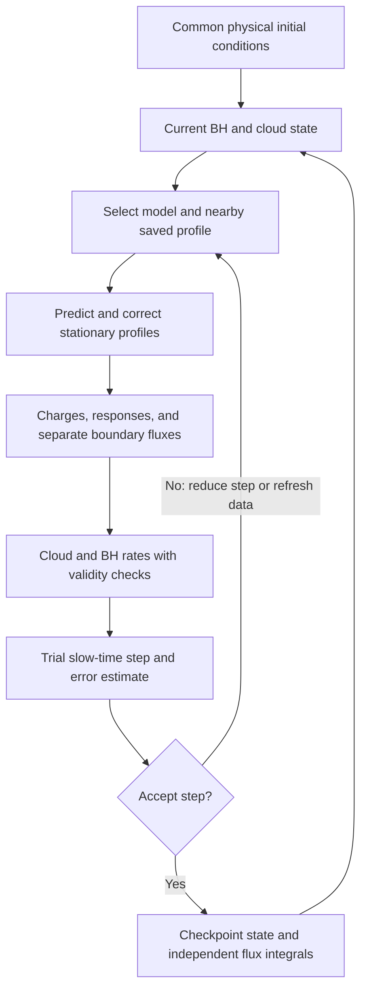

# QCD two-cloud time evolution: comparison design

Draft, October 30, 2026. This note defines the next comparison and maps it onto
existing code. It does not announce a new implementation or submitted run.
[HANDOFF.md](../HANDOFF.md) owns current status; the
[multiphase campaign](../runs/adiabatic/multiphase_two_cloud/README.md) owns
saved results and execution recipes.

November 2 update: the user selected the leading-order chiral QCD potential
for new joint evolution, while retaining cosine for a faithful Omiya
reproduction. A separate exploratory fixed-BH alpha=0.42 run is now the first
execution step; it does not implement the BH-coupled comparison below.

## Aim and scope

Determine whether allowing both clouds to deform changes peak populations,
saturation timing, coexistence, or quasi-equilibrium. Evolve the 211 and 322
clouds together with BH mass and spin, starting from the same physical initial
conditions in each approximation. This is slow adiabatic evolution through
stationary configurations, not a direct simulation resolving every axion
oscillation.

The completed 36-point static campaign supplies useful profile checks, but
its first-saturation population estimates leave the other cloud microscopic.
Its joint curves use the coupled small-secondary limit. Those results do not
establish the effect of mutual deformation along an evolving two-cloud system.
Evolution will select the later populations instead of imposing a guessed
large secondary cloud merely to make deformation visible.

Keep the user's current choices:

- QCD mass–decay-constant relation and the leading-order chiral potential for
  new joint evolution. The current quark-mass ratio is z=2.2/4.79, giving
  c4=(1-z+z^2)/(1+z)^2=0.352968986964824. The faithful Omiya reproduction keeps
  its cosine potential and c4=1. Neither the old c4=0.3 population diagnostic
  nor cosine tables supply consistently normalized chiral rates.
- Both clouds remain in the outputs even when one is tiny.
- Start histories at the same BH mass/spin and seed populations. Matching
  outer coefficients alone is insufficient because their physical
  normalization depends on the profile and approximation.
- Match each cloud's energy across models for diagnostic profile snapshots.
  Allow independently evolved populations and energies to differ.

Start with one controlled pilot, not another full parameter sweep. The
existing alpha=0.3, spin=0.99, initial BH mass 5 solar masses case is a useful
first control: mu=8.018e-12 eV and fa=7.109e17 GeV. It may show a small effect;
that is an informative outcome. Add a dominant-322 control after the first
comparison works. Seed choices and duration are still to be specified for the
new evolution; the static first-peak energies are not initial seeds.

## What the three models mean

| Model | Spatial approximation | Evolution ingredients |
|---|---|---|
| Linear profiles with perturbative interactions | Relativistic free Kerr 211/322 profiles, refreshed as the BH changes | Dilute growth and leading transfer/radiation rates evaluated consistently on those profiles |
| Omiya | Nonlinear primary; secondary on its averaged background; driven scalar fields; no secondary deformation of the primary | Existing energy/angular-momentum balance with population-dependent coefficients |
| Joint | Both bound profiles and retained driven components respond to the two amplitudes | Joint charges, their responses, and boundary fluxes; small-secondary limit only while controlled |

With the November 2 potential choice, comparing chiral joint evolution to the
faithful cosine Omiya reproduction changes both potential and spatial
approximation. Isolating deformation would require a separately labeled control
with the same potential (for example a joint cosine run); do not modify or
relabel the faithful reproduction to hide this distinction.

The first row is the proposed deformation baseline. A purely noninteracting
linear evolution can be an additional control, labeled separately. Turning
off scalar transfers only in the linear model would mix the effect of adding
interactions with the effect of deforming the profiles.

Use the same dilute relativistic growth rates, time convention, potential
normalization, and common physical channels wherever the approximations agree.
First compare a common retained component set; then measure the effect of
additional joint harmonics. Record channels present in only one model.

For cloud order (211,322), the leading driven components have Fourier labels
(2,-1) and (-1,2), azimuthal numbers m=0 and m=3, and real frequencies
2 omega211 - omega322 and 2 omega322 - omega211. These labels describe
responses driven by the two clouds, not two additional independent
populations. If the computational primary/secondary order is reversed, map
these labels explicitly. The old Omiya balance helpers hard-code m1=1,
m2=2; a dominant-322 comparison is not obtained by simply swapping arguments.

Omiya's fixed-background model is the reference for the second row, including
its approximation to the cloud angular momentum. Its dimensionless
large-amplitude example need not be physically accessible for our stellar-mass
QCD parameters. Keep it as a numerical regression case, not the starting
population of the QCD evolution. [Omiya et al., Sections III and VI](https://arxiv.org/html/2211.01949v1)

## What we can reuse

Paths below point to existing code, not proposed new modules.

| Existing piece | Reuse | Limit or required change |
|---|---|---|
| [Omiya evolution](../src/adiabatic/primary_secondary/evolution.jl): `two_cloud_coefficients`, `two_cloud_rates`, `evolve_two_clouds` | Factored flux interpolation, frequency derivative, two-charge balance, logarithmic energies, RK4 reference integration | Current coefficient tables are one-dimensional in primary energy at fixed BH parameters |
| [Reference tables](../src/adiabatic/primary_secondary/reference_tables.jl): `read_two_cloud_table`, `fig6_evolution` | Existing Fig. 6 regression at alpha=0.3 and 0.42 | Saved tables and initial energies reproduce that calculation; they are not a changing-BH QCD table |
| [Scalar accounting](../src/adiabatic/primary_secondary/scalar_energy_accounting.jl) | Separate horizon/outward channel fluxes and cumulative budgets | The fixed-BH total-flux RHS alone cannot supply BH evolution |
| [Coupled balance](../src/adiabatic/primary_secondary/coupled_balance.jl) | Fixed-reference units, BH mass/torque equations, leading Omiya cloud law, optional work/response inputs | The helpers do not calculate physical metric work or joint background response |
| [Earlier QCD integrator](../src/adiabatic/primary_secondary/qcd_spindown.py) and [campaign](../runs/adiabatic/qcd_spindown/README.md) | Positive logarithmic state, adaptive integration, separate channel projection, refreshed horizon factors, independent loss integral | Hard-coded physical case and one trajectory-specific table; comparator uses nonrelativistic noninteracting clouds |
| [Joint response](../src/adiabatic/multiphase/response.jl) and [core sensitivity](../src/adiabatic/core/sensitivity.jl) | Corrected profiles and implicit derivatives; one matching-Jacobian factorization for both amplitude directions | Background derivatives are not exposed by the current two-amplitude wrapper; numerical and physical closure checks remain |
| [Joint evolution](../src/adiabatic/multiphase/evolution.jl) | Scaled E/J solve, log-amplitude midpoint steps, response predictors, corrected stages, independent loss budgets | Fixed BH; amplitude-target termination is unsuitable for following a peak into decay or equilibrium |
| [Joint campaign driver](../runs/adiabatic/multiphase_two_cloud/scripts/response_and_evolution.jl) | Frozen sources, corrected-neighbor checks, accepted-step checkpoints and CSV histories | Reuse the pattern, not its short-domain pilot settings or assumed return-field compatibility |
| [Current QCD probe driver](../runs/adiabatic/multiphase_two_cloud/scripts/qcd_joint_probe.jl) | Stable unit-secondary response and coupled return channel at extreme population hierarchy | Static profile/source validation does not yet validate a physical evolution rate |

The October 15 frozen joint pilot checked amplitude derivatives against
independently corrected neighbors and demonstrated second-order time/budget
convergence. That establishes useful numerical machinery, not spatial
convergence or the physical slow-growth closure. The October 19 doubling run
is another fixed-background regression, not the requested QCD comparison.

Before reusing the current tree, reconcile a concrete interface mismatch:
`two_cloud_balance_rates` returns `log_rates`, `scaled_condition`, and
`balance_residual`, while
[test_evolution.jl](../tests/adiabatic/multiphase/test_evolution.jl) still expects
`amplitude_rates`. This was confirmed by reading the code; the tests were not
rerun while writing this note. Historical passing counts apply to their
frozen sources. The later full-domain derivative discrepancy also remains a
separate item to resolve on the actual pilot configuration.

The intended first implementation is a thin Julia campaign driver composing
these pieces. Preserve the Python spin-down result as a regression. Do not
begin by replacing both integrators or building a general evolution framework.

## State, units, and cloud diagnostics

Use the fixed-reference convention of the
[coupled balance note](coupled-bh-cloud-balance.md). In G=c=hbar=1 units, define

$$
\tau=t/M_0,\qquad b=M_{\rm BH}/M_0,\qquad
j=J_{\rm BH}/M_0^2,\qquad
\epsilon_f=(f_a/M_{\rm Pl})^2,
$$

where M0 is the initial BH mass and MPl is unreduced. The physical particle
mass and decay constant remain fixed. The instantaneous profile solver sees

$$
\alpha=\alpha_0 b,\qquad \chi=j/b^2.
$$

Omiya can retain its positive reference energies
q_i=E_i/(epsilon_f M0), with instantaneous code energies e_i=q_i/b. The joint
solver naturally uses two positive outer amplitudes A_i; let u_i=ln A_i.
Different internal coordinates are acceptable if the same physical initial
conditions, units, and approximation order are enforced.

For the joint family, call its integrated dimensionless total energy e and
angular momentum ell. Define the fixed-reference charges

$$
Q_E=b\,e(\mathbf u;\alpha,\chi),\qquad
Q_J=b^2\ell(\mathbf u;\alpha,\chi),
$$

so physical cloud energy and angular momentum are epsilon_f M0 Q_E and
epsilon_f M0^2 Q_J. Here ell denotes a total charge, not the angular index l.
The joint stress tensor includes interaction terms: do not replace its total
energy by a sum of separately evaluated isolated-cloud energies.

Save per-cloud energies using a documented projection/convention for plotting,
and save the difference from the full joint total separately. In the dilute
limit, N_i approximately equals E_i/omega_i. At finite nonlinear amplitude
this is an occupation proxy, not an automatically conserved particle number
or a derived phase action. Report energy peaks as well as proxy occupation
peaks; do not claim a unique nonlinear population partition before defining it.

## Balance equations: existing fixed-BH law and the new extension

### Fixed background

Let s=t/M_BH for a fixed BH. The existing Omiya equations use the matrix

$$
\begin{pmatrix}
1&1\\
1/\hat\omega_1-(2e_2/\hat\omega_2^2)
\,\partial_{e_1}\hat\omega_2&2/\hat\omega_2
\end{pmatrix}
\frac{d}{ds}\begin{pmatrix}e_1\\e_2\end{pmatrix}
=-\begin{pmatrix}F_H+F_o\\T_H+T_o\end{pmatrix}.
$$

H denotes the horizon and o the outward boundary; F and T are signed energy
and angular-momentum fluxes. A positive horizon flux enters the BH, so
superradiant extraction has negative F_H. Frequencies with hats are real
carrier frequencies in current-BH units. The primary's nonlinear angular
momentum obeys the branch derivative used by Omiya; it is not simply e1/omega1.
See the [existing derivation](multimode-adiabatic-design.md#reproduction-pieces)
and the local paper's Eqs. (62)–(63), (72).

The existing joint equivalent is

$$
\frac{\partial(e,\ell)}{\partial\mathbf u}
\frac{d\mathbf u}{ds}
=-\begin{pmatrix}F_H+F_o\\T_H+T_o\end{pmatrix}.
$$

`two_cloud_balance_rates` already implements this through amplitude
derivatives multiplied by A_i, with row scaling and a condition diagnostic.
Use derivatives along the corrected stationary family, not derivatives that
hold its radial shape fixed.

The joint matcher uses complex trial frequencies. Its current observable
adapter uses their real parts and omits slow profile time derivatives. This
is an explicit approximation needing validation, not a license to identify
every imaginary part with a physical growth rate. Once balance supplies
the amplitude rates, do not add a separate exponential from the same matching
frequency. In the dilute fixed-background limit, check d ln A_i/ds=Im omega_i
and d ln E_i/ds=2 Im omega_i, including normalization conventions.

### Changing BH

The existing leading horizon balance is reusable:

$$
b'=\epsilon_f F_H,\qquad
j'=\epsilon_f b T_H,\qquad
\chi'=j'/b^2-2\chi b'/b,
$$

where primes mean d/dtau. Scalar radiation outward does not directly enter
the BH mass equation. The physical fluxes are epsilon_f F and
epsilon_f M_BH T; the extra mass in torque must be retained.

For the joint coordinates, the chain-rule structure to audit is

$$
\frac{\partial(Q_E,Q_J)}{\partial\mathbf u}\mathbf u'
=-\begin{pmatrix}F_H+F_o\\b(T_H+T_o)\end{pmatrix}
+\begin{pmatrix}w\\0\end{pmatrix}
-\left.\frac{\partial(Q_E,Q_J)}{\partial b}\right|_{\mathbf u,j}b'
-\left.\frac{\partial(Q_E,Q_J)}{\partial j}\right|_{\mathbf u,b}j'.
$$

Here w is the physical metric-work power divided by epsilon_f, under the
coordinate and boundary convention of the coupled balance note. This is a
design/accounting equation; the required joint background responses and work
are not implemented. Changing alpha/spin inside the old fixed-BH integrator
does not supply them. Even at frozen b different from one, the rate per tau
is the current-BH rate divided by b.

The existing Omiya `leading_coupled_rates` takes a specific leading
instantaneous-background approximation: it drops metric work and background
angular response together in reference-energy coordinates. Reusing it for
joint amplitudes requires deriving the equivalent truncation and coordinate
transport. Simply dropping every background derivative in the equation above
would generally change the model and mishandle energy units. Likewise,
retaining background derivatives while setting w=0 is a specified zero-work
family model, not a completed physical treatment of the changing metric.

For the first BH-coupled pilot, document and match the leading approximation
across all three models, recover the existing Omiya law, and estimate the
omitted terms relative to the effect being measured. A manufactured cloud
with conserved occupations under prescribed background variation is a
decisive check of the coordinate/work bookkeeping. Full gravitational
backreaction is not a prerequisite for a clearly limited leading-order pilot.
However, percent-level mutual-deformation claims need those omissions under
control; an algebraically exact truncated energy budget alone is insufficient.

The current boundary currents and charges use finite radial domains, with
infinity extraction for some radiative channels. Keep the integration region,
tails, and any moving-boundary transport consistent in background comparisons.
The same caution applies near a driven resonance or a bound/outgoing threshold.

### Other losses

Reuse the scalar-only model first as a labeled control. For a trajectory meant
to address later secondary growth or quasi-equilibrium, estimate GW depletion
on the actual trajectory and include it if competitive. GW losses require
consistent energy and angular momentum contributions in each model; they are
not supplied by the existing scalar fluxes. The earlier QCD spin-down pilot
also omits self-gravity and higher-order metric work. Track cloud mass fraction
and rate sensitivity to delimit interpretation of such omissions.

## Seeds and the transition out of the small-secondary regime

Use one documented seed prescription across models. Occupation-one seeds may
be represented by an analytic/rate-equation early stage, explicitly treated
as a seeding approximation rather than a precise classical field prediction.
Alternatively start with common small classical seeds and state that time
zero. Do not compare saturation times with different seed histories hidden in
their origins. Vary the seed normalization when interpreting timing sensitivity.

The current static configurations can have amplitude ratios around 1e-40.
Logarithmic populations prevent underflow, but do not prevent cancellation in
a full-field projection or subtraction of large total fluxes. Reuse unit-probe
normalization and analytically factored small-population powers. The earlier
QCD RHS's channel-by-channel projection is useful here.

While the secondary is negligible, evolve its normalized coupled response and
the dominant cloud with the appropriate asymptotic equations. This still
retains the secondary's response to the dominant cloud; it is not equivalent
to deleting that cloud. Validate the resulting physical rate separately from
the static eigenfunction checks.

Switch to a full two-amplitude joint solve in an overlap region where both
formulations are numerically reliable. Locate that region by agreement of
charges, fluxes, and rates and by estimated neglected terms, rather than an
arbitrary population ratio alone. Check continuity and independence of the
switch location. If the secondary never becomes significant, retain and
report that outcome; do not manufacture a large population to exercise the
finite-population solver in a physical trajectory.

## Numerical workflow and cost

The diagram describes the intended driver, not a new implemented API. A model
sample should expose the corrected profile, charge and flux conventions,
responses/rates, residuals, conditioning, and source/configuration identity.
Keep any adapter small and model-specific; do not pass Omiya's two isolated
energies to the joint balance as though they were its total interacting charge.

Avoid repeating the costly amplitude-to-target-energy search at every step.
Calibrate the common initial physical state once. Thereafter evolve native
positive coordinates and use the previous corrected state plus its implicit
response as the next predictor. Energy is an output of the joint state.
Requested equal-energy snapshots can be solved separately at selected times.
No nonlinear profile is rescaled to fake a target energy.

For the first direct joint steps, reuse the existing corrected-midpoint scheme
and independent loss integration. Add time-error control and retry behavior
only as needed; its current maximum-log-step limiter is not an error estimate.
A decreasing primary is a physical possibility, not an automatic termination:
`evolve_two_phase_to_amplitude` stops at growth stalling and is unsuitable for
the complete saturation/decay history. Detect peaks as events or resolved
turning points while continuing the trajectory.

Benchmark one complete corrected step, including responses and observables,
before estimating campaign cost. Reuse one matching-Jacobian factorization
for several response directions where the implementation allows it. A fast
source evaluation alone is not an evolution-step benchmark.

Use interpolation after direct samples establish accuracy. The Omiya strategy
of factoring the leading E1, E2, E1^2 E2, and E1 E2^2 powers is reusable. Preserve
its interpolation in primary energy where the factored coefficients are smooth;
using log energies for time evolution does not require splines in log energy.
Preserve the correct horizon zero as spin changes, following the earlier stationary
track's approach, and validate fresh samples on the actual path. A single
primary-energy spline cannot represent independent alpha, spin, and secondary
amplitude dependence. Prefer a small local cache along the trajectory to a
dense four-dimensional table initially. Reject unvalidated extrapolation.

A threshold crossing, profile-branch change, invalid BH state, large balance
condition number, or failed rate/sample check must produce an explicit event,
retry, or validity stop. Do not silently continue across a change in the
bound/outgoing boundary condition. Resume only with the saved source and
configuration; keep one writer per checkpoint and run heavy solves in Slurm.

## Incremental implementation and decisive checks

| Step | Work | Evidence before extending |
|---|---|---|
| 1. Recover the existing evolutions | Reconcile the current response/evolution interface and replay a short frozen Omiya and joint case | Existing numerical history reproduced with declared source versions; analytic exponential and factor-of-two checks |
| 2. Compare instantaneous fixed-BH rates | Implement the thin linear-profile/Omiya/joint adapters at common physical states | Dilute and one-cloud limits; channel signs/multiplicities; E/J derivative neighbor checks; radial/component sensitivity of the rates |
| 3. Make the extreme population hierarchy usable | Connect the unit-secondary calculation to a validated rate law and identify an overlap with finite-population joint profiles | Secondary rates survive changes in normalization; overlap rates/charges agree; no cancellation-driven growth signal |
| 4. Add changing-BH balance | Reuse fixed-reference units and horizon laws; derive the matched leading joint background transport | Recovery of the existing Omiya leading law, nonunit-b conversion, fixed-BH limit, and prescribed-background occupation check with explicit omitted terms |
| 5. Run a short common-seed QCD pilot | Evolve all three models with consistent channels and record physical time | Fresh stationary spot checks, time refinement, independently accumulated budgets, complete-step cost, and seed/time-origin metadata |
| 6. Extend through the first peak and later evolution | Follow decline, coexistence, and quasi-equilibrium where the model remains valid; include competitive losses | Peak values/times converge; GW/omitted-term estimates support interpretation; no extrapolation or hidden validity stops |
| 7. Expand deliberately | Add a reversed-dominance control and further parameters informed by the pilot | Comparable accuracy and tractable cost; clearly distinguish a null effect from unresolved numerics |

Do not require a new broad scan before the first evolution comparison. The
numerical uncertainty should be smaller than the claimed model difference;
set a pilot error budget after measuring the rate and trajectory sensitivities.
If the difference lies below that budget, report it as unresolved.

## Outputs and definition of completion

Each run should save its source snapshot, model approximation, potential,
physical parameters, seeds/time origin, retained components, spatial settings,
time tolerance, interpolation checks, loss channels, and termination reason.
Save accepted states with BH mass/spin, both amplitudes, both diagnostic
energies and occupations, full joint charges, real and trial-imaginary
frequencies, separate horizon/outward fluxes and torques, growth rates,
condition numbers, residuals, and independent cumulative losses.

The first comparison figure should show both cloud histories, BH spin/mass,
and inter-model differences. A feature table should give each cloud's peak
energy/proxy population and time, the duration and level of coexistence, and
any quasi-equilibrium interval. Define quasi-equilibrium by small relative
cloud rates over a stated interval with source/loss balance; it need not mean
the BH has stopped evolving. A finite run ending before a peak or equilibrium
is a censored result, not evidence that neither occurs.

Completion of the first scientific pilot means a common-seed three-model
trajectory through the first peak or a documented physical validity limit,
with matched BH treatment and numerical/model error estimates. A successful
ODE return, a visually smooth history, or agreement of the static profiles
alone is not that checkpoint.

## References and relation to older plans

- [Omiya et al., 2211.01949v1](papers/2211.01949v1.pdf): fixed-BH nonlinear-primary/test-secondary reference; use PDF equation numbers.
- [Baryakhtar et al., 2011.11646](https://arxiv.org/abs/2011.11646): perturbative population-transfer regimes and the role of losses. Any imported coefficients must be converted to this campaign's cosine convention.
- [Multimode design](multimode-adiabatic-design.md): implemented Omiya equations and coefficient choices.
- [Coupled BH–cloud balance](coupled-bh-cloud-balance.md): leading approximation, metric work, background response, and the distinction between bookkeeping and physical accuracy.
- [Earlier multiphase plan](multiphase-implementation-plan.md): fixed-BH joint response/closure milestones. This note brings BH evolution into the current two-cloud comparison; third-cloud action closure remains a later extension.
- [Current handoff](../HANDOFF.md#next-steps): priorities and remaining checks.
